# How the assistant decides

This is an implementation map of the plugin and simulator. Start with the pictures; each condition table gives the precise rule and the function that owns it. “Abstain” means the app cannot justify this answer with its available evidence. It does not mean the coffee is bad.

Reviewed base: `745e1bdbcbcf4b06fba4818edfdd11653c1b3245`. The review includes uncommitted working-tree changes, so the base commit alone does not identify the implementation. Exact file hashes and the branch inventory are in [decision-tree-map.json](research/decision-tree-map.json).

The numeric thresholds below are implementation policy or constants recovered from `HEM-HSG-HMI-S01 V01.16-24`. They are **not scientifically validated universal espresso thresholds**. Replay correctness, physical grinder suitability, measured shot quality and sensory preference are separate claims. The plugin sends no command to change a grinder.

Every diagram has an offline [SVG](decision-trees/) and an editable Mermaid source. Existing behavior tests are linked as evidence pointers, not a claim that every line or every combination has been tested. The JSON groups validation branches; it is not an instrumented line-coverage report.

Implementation sources: [plugin.js](../plugin.js), [simulator/app.js](../simulator/app.js), [simulator/engine.js](../simulator/engine.js), [catalog updater](../scripts/update-coffee-catalog.py).

| Calculation family | Applicability and provenance |
| --- | --- |
| GbS1–GbS4, DdEff | Pinned-build recovered arithmetic; caller supplies time, coordinate and state. No verified grinder-model-to-algorithm assignment. |
| effectiveDd, grindTime, inverseRegression | Supporting calculations with their own units and preconditions; not independent taste recommendations. |
| proposedDd wizard | Model/roast table replay; output coordinate unit remains unknown. |
| Manual E64 WS / DF54 / DF64 | Community heuristic with explicit inputs and owner dial calibration; not recovered firmware. |
| Rich suggestion | Local matched-history heuristic; abstention and owner-step gates below. |
| Research compare | Ten isolated results; computed does not mean physically applicable or scientifically ranked. |

## Choose the kind of answer

The app has separate ways to recall a good shot, suggest a next experiment, describe a saved trace, and replay recovered calculations. A calculated number does not become a machine command.

Functions: `createPlugin.handleHttpRequest`, `recommendation`, `suggestion`, `analysis`, `research`.

[Open full-size SVG](decision-trees/entry.svg) · [Mermaid source](decision-trees/entry.mmd)

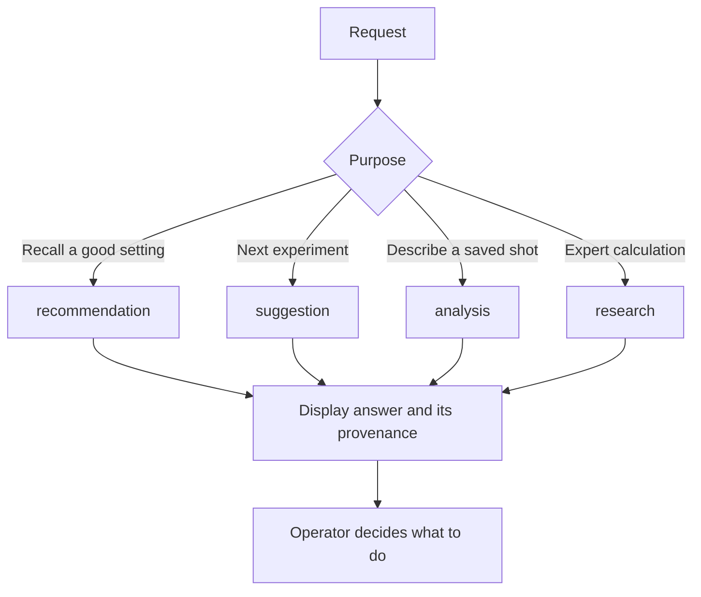

| Condition | Result |
| --- | --- |
| GET recommendation | Recall most recent comparable marked-good setting. |
| GET suggestion | Run current-context, historical-evidence and sensory gates. |
| POST analysis with shotId | Describe saved full-shot telemetry and local feedback. |
| POST research | Validate isolated caller inputs and replay the requested calculation. |
| inactive plugin or failed host/storage dependency | Return unavailable; never invent a replacement answer. |
| unknown endpoint or method | 404. |

Behavior evidence: [test/plugin.test.js](../test/plugin.test.js), [test/analysis-endpoint.test.js](../test/analysis-endpoint.test.js), [test/research-endpoint.test.js](../test/research-endpoint.test.js).

## Measurements, missing values and units

A recipe is an intended amount; an annotation can be manually entered; the scale records mass. Keeping these separate prevents an intended yield from appearing to be measured.

Functions: `createBrewMetrics.analyze`, `samples`, `ordered`, `scaleMetrics`, `timedMetric`.

[Open full-size SVG](decision-trees/metrics.svg) · [Mermaid source](decision-trees/metrics.mmd)

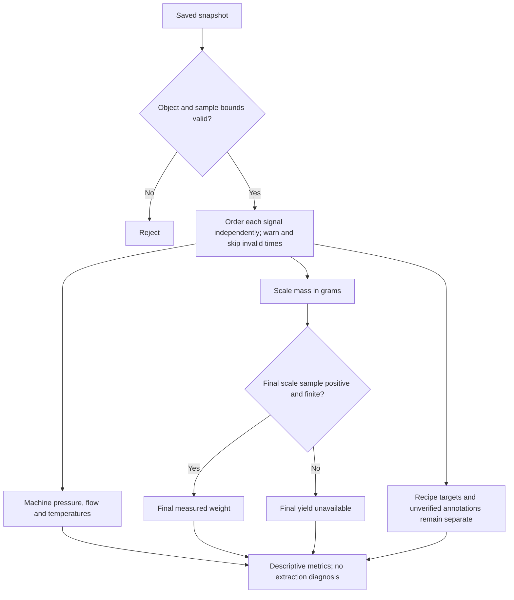

| Condition | Result |
| --- | --- |
| shot is not an object, more than 20000 measurements, or non-finite result | Reject analysis. |
| timestamp invalid or not strictly increasing within one signal | Exclude sample and warn; machine and scale clocks are processed separately. |
| finite positive recipe dose and finite non-negative recipe yield | Expose targets and their ratio; never rename targets as measurements. |
| finite saved actualDoseWeight/actualYield | Expose annotations with origin unverified. |
| last ordered scale sample has finite weight > 0 | Expose finalMeasuredWeightG; otherwise null even if an earlier positive value exists. |
| at least two valid scale samples and positive elapsed time | Report mass gain divided by scale elapsed time in g/s. |
| finite measured value and target at both interval endpoints, with 0 < dt <=5000 ms | Accumulate left-sample-held time-weighted absolute target error; missing values/targets and longer gaps do not contribute. |

Behavior evidence: [test/brew-metrics.test.js](../test/brew-metrics.test.js), [test/analysis-endpoint.test.js](../test/analysis-endpoint.test.js).

## Trace coverage and descriptive irregularity

A missing interval is a gap in evidence. Machine inlet flow in ml/s and beverage mass flow in g/s are different quantities.

Functions: `traceMetrics.integrate`, `traceMetrics.massRate`, `traceMetrics`.

[Open full-size SVG](decision-trees/trace.svg) · [Mermaid source](decision-trees/trace.mmd)

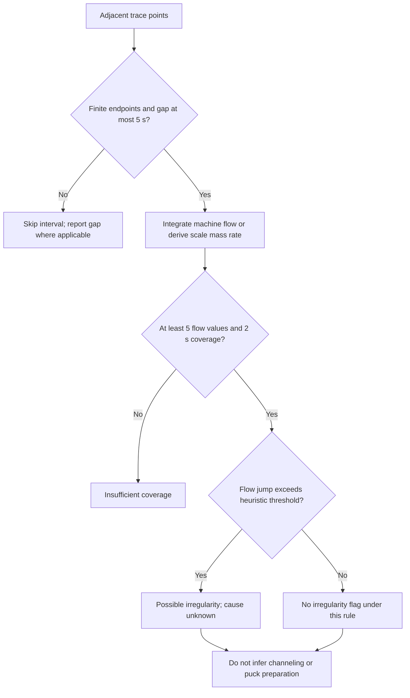

| Condition | Result |
| --- | --- |
| adjacent finite endpoints and interval 0 < dt <= 5000 ms | Trapezoidal machine-flow integral; scale mass difference divided by elapsed time. |
| dt > 5000 ms | Count a gap and exclude interval from integration. |
| missing/non-finite endpoint or negative scale mass | Skip derivative interval; do not bridge it. |
| at least five finite machine flow samples and >=2 seconds covered | Report observed_trace; possibleIrregularity means at least one adjacent finite flow change within the same frame and a gap <=5 s exceeds max(0.5 ml/s, abs(current targetFlow)*0.5), using target 1 when unavailable. This is an implementation heuristic. |
| scale mass decreases across an otherwise usable interval | Count observed weight decrease and exclude that interval from beverage-rate integration; do not diagnose a reset or puck cause. |
| less coverage | Report insufficient_trace_coverage and null irregularity/preparation inference. |
| more than 600 timestamp-merged graph points | Return first 600 sorted points and truncation warning. |

Behavior evidence: [test/brew-metrics.test.js](../test/brew-metrics.test.js), [test/suggestions.test.js](../test/suggestions.test.js).

## Observed phases and inferred roles

Recorded frame changes establish observation windows. A saved step name or volume-count boundary can label the window, but does not prove puck saturation. Programmed maximum durations are never substituted for observed phase timing.

Functions: `frameRuns`, `profileSegments`, `traceMetrics`, `stateTiming`.

[Open full-size SVG](decision-trees/phases.svg) · [Mermaid source](decision-trees/phases.mmd)

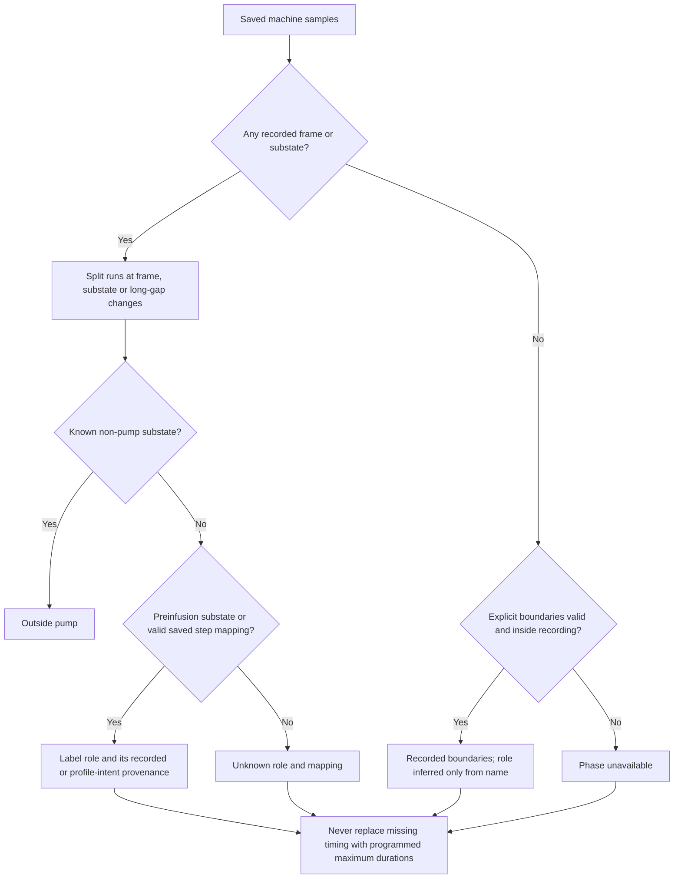

| Condition | Result |
| --- | --- |
| any machine sample contains integer profileFrame or substate | Prefer recorded frame/substate runs; do not fall back to explicit phase arrays for unmapped runs. |
| same non-negative integer frame and same substate, adjacent gap <=5000ms | Continue run; at a contiguous transition close previous run at the transition timestamp; a longer gap starts a separate run. |
| known substate other than preinfusion/pouring | Role outside_pump, without a pump mapping. |
| substate preinfusion | Role preinfusion with recorded_machine_substate provenance. |
| valid saved step pump flow/pressure at recorded frame | Map saved step; role preinfusion when index is below positive integer target_volume_count_start or name matches pre.?infus/infus/bloom/soak/fill; otherwise extraction. |
| frame unmapped or unsupported saved step | Keep role unknown and mapping unknown. |
| no frame/substate observations | Use first nonempty explicit phase array in phases/phaseEvents/profilePhases/annotations.phases/workflow.phases order. |
| explicit phase has finite 0<=start<=end<=last machine elapsed | Use recorded_phase_boundary; infusion-like name supplies preinfusion role, other roles remain unknown. |
| no observed phase boundary | Phase unavailable; no schedule-duration fallback. |
| preinfusion phases available | Report observed window sum; extractionElapsedSec comes only from complete recorded pouring-substate timing. |

Behavior evidence: [test/brew-metrics.test.js](../test/brew-metrics.test.js), [test/analysis-endpoint.test.js](../test/analysis-endpoint.test.js).

## Recording, pump and pouring clocks

A file can include heating or a tail after pumping stops. Recording elapsed time, pump duration and pouring duration are reported as different clocks.

Functions: `stateTiming`, `stateTiming.window`, `createBrewMetrics.analyze`.

[Open full-size SVG](decision-trees/timing.svg) · [Mermaid source](decision-trees/timing.mmd)

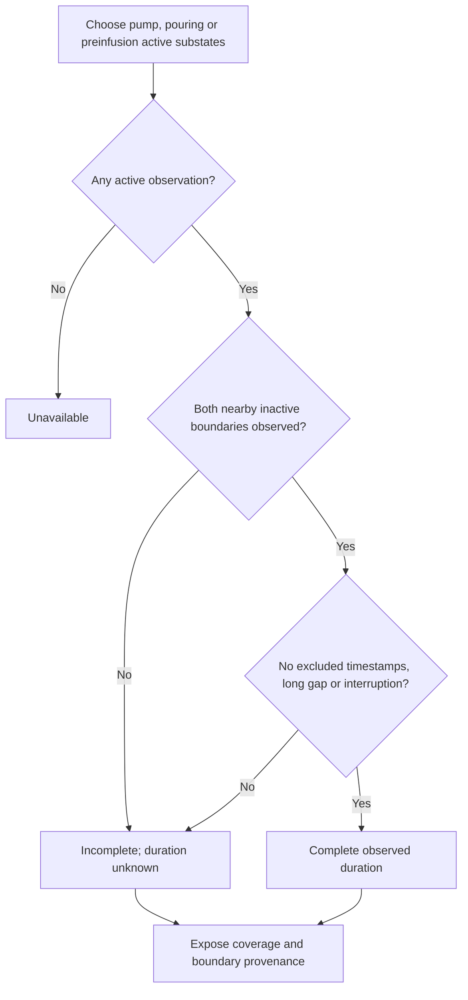

| Condition | Result |
| --- | --- |
| recording start and machine end are valid | elapsedSec describes recording duration; it does not become pump duration. |
| state.state is espresso and substate belongs to requested active set | Count as active: pump uses preinfusion+pouring, pouring only pouring, preinfusion only preinfusion. |
| first/last active observation lacks a nearby known inactive boundary | Duration unknown; availability and observed start/coverage remain visible. |
| gap >5000ms, missing next substate, or non-active sample interrupts active span | Window incomplete; do not publish a complete duration. |
| any machine sample was excluded for invalid, duplicate or non-monotonic timestamp | All pump/pouring/preinfusion windows have complete false, durationSec null and timestampIntegrity excluded_samples. |
| both boundaries observed, no excluded machine timestamp and no gap/interruption | durationSec is first following inactive timestamp minus first active timestamp. |
| complete pouring window unavailable | Preinfusion extractionElapsedSec remains null, rather than subtracting guessed preinfusion from total recording. |

Behavior evidence: [test/brew-metrics.test.js](../test/brew-metrics.test.js), [test/analysis-endpoint.test.js](../test/analysis-endpoint.test.js).

## Control mode and the time-only advice gate

Under flow control or a positive opposite-variable limiter, elapsed time can be a profile outcome rather than a simple sign of grind resistance. Saved controls, rather than profile title, determine the classification.

Functions: `traceMetrics`, `suggestion`.

[Open full-size SVG](decision-trees/control.svg) · [Mermaid source](decision-trees/control.mmd)

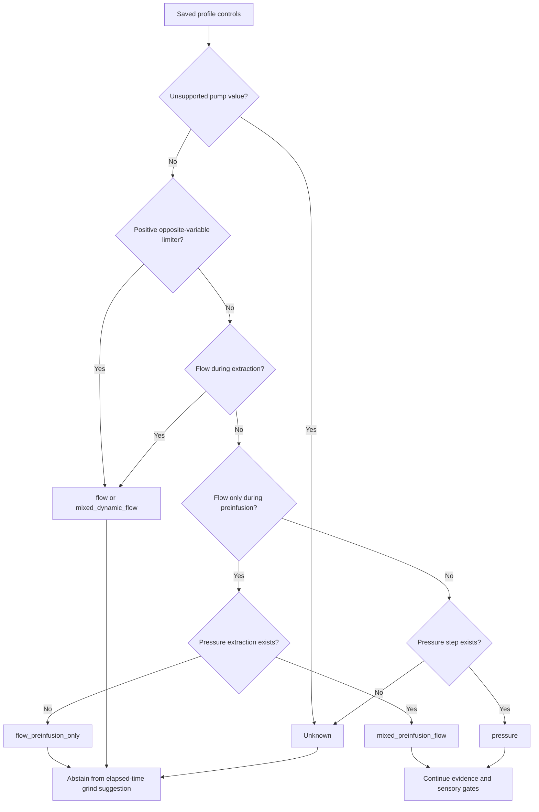

| Condition | Result |
| --- | --- |
| any saved step pump is not exactly flow or pressure | Control mode unknown; title alone never classifies it. |
| positive numeric step.limiter.value and recognized controls | mixed_dynamic_flow when any pressure step exists; otherwise flow when a flow step exists. |
| pressure and flow steps and flow outside preinfusion classification | mixed_dynamic_flow. |
| pressure and flow steps, flow only preinfusion | mixed_preinfusion_flow. |
| only flow steps | flow if any extraction step, otherwise flow_preinfusion_only. |
| only pressure steps without positive limiter | pressure. |
| no recognized control steps | unknown. |
| preinfusion classification | Index below positive integer target_volume_count_start, or step name matching pre.?infus/infus/bloom/soak/fill; numeric strings are accepted for profile numeric fields. |
| any selected evidence control mode other than pressure or mixed_preinfusion_flow | Abstain before taste-based numeric advice. |
| mixed_preinfusion_flow or pressure | This controller gate allows continuation; all other evidence and sensory gates still apply. |

Behavior evidence: [test/brew-metrics.test.js](../test/brew-metrics.test.js), [test/suggestions.test.js](../test/suggestions.test.js).

## Current context and historical matching

An old shot must keep its old identity. Current settings can fill current setup fields, but are never silently copied into historical shots.

Functions: `contextOf`, `profileContent`, `canonical`, `historicalContext`, `compare`.

[Open full-size SVG](decision-trees/context.svg) · [Mermaid source](decision-trees/context.mmd)

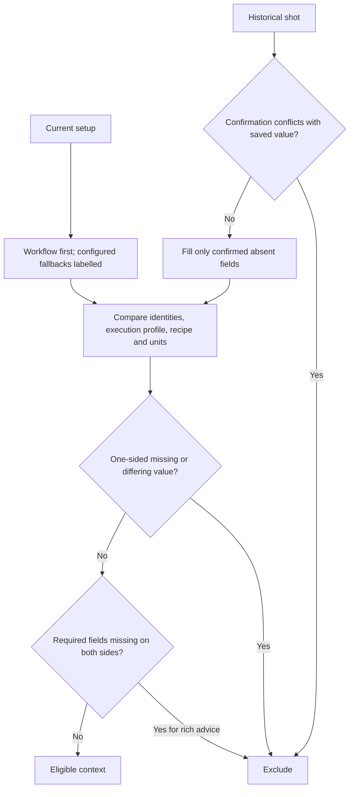

| Condition | Result |
| --- | --- |
| current workflow field absent and useSettings true | Allow configured current fallback and report userSuppliedCurrentFields. |
| historical field absent and explicit confirmedContext supplied | Fill only confirmed missing field. |
| historical field already present and differs from confirmation | Reject conflicting historical confirmation. |
| profile has no nonempty steps | Profile execution identity unavailable. |
| execution content exists | Canonicalize selected execution fields with sorted object keys; display title is not identity. |
| comparison field missing on one side | Exclude as missing. |
| comparison field differs | Exclude as mismatched. |
| comparison field missing on both sides | Report unavailable; rich suggestion permits this for beanType, roastLevel, grinderRpm, machineId and machineFlowCalibration. |
| known RPM, machine identity or recorded flow-calibration strings differ | Exclude; unavailable optional metadata is not proof of matching physical conditions. |

Behavior evidence: [test/suggestions.test.js](../test/suggestions.test.js), [test/first-shot.test.js](../test/first-shot.test.js), [test/grinder-instances.test.js](../test/grinder-instances.test.js), [test/plugin.test.js](../test/plugin.test.js).

## Select evidence before suggesting a change

The assistant selects up to six comparable observations at the current intended setting. More unrelated shots do not make a suggestion stronger.

Functions: `suggestion`, `fetchShots`, `fullShot`.

[Open full-size SVG](decision-trees/cohort.svg) · [Mermaid source](decision-trees/cohort.mmd)

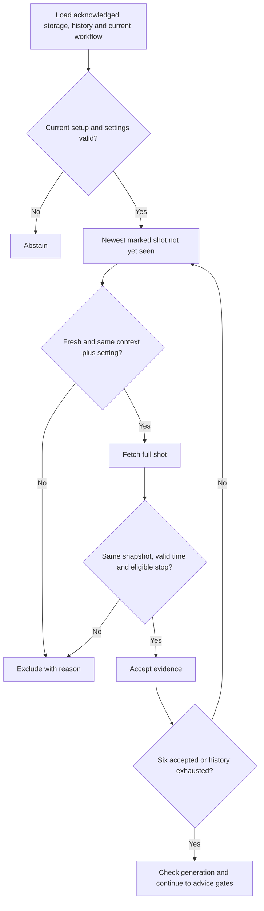

| Condition | Result |
| --- | --- |
| current required setup/setting absent, dose/yield not positive, target outside (0,600], tolerance outside [0,target), or maxAge outside (0,365] days | Abstain. |
| unmarked or duplicate shot | Skip. |
| shot age invalid, future, or older than EvidenceMaxAgeDays (default 14) | Exclude. |
| context or intended setting differs | Exclude; numeric setting strings compare numerically when both parse. |
| full snapshot context/timestamp differs from summary | Exclude to prevent a mixed historical snapshot. |
| operator brewTimeSec supplied | Require operator brewTimeClock (legacy default pump) equals target clock; use that confirmed time. |
| no operator time | Require complete observed pump/pouring boundaries, or valid recording endpoints when recording clock explicitly selected; otherwise exclude. |
| TargetTimeSec absent/non-finite/non-positive or TargetTimeClock invalid | Abstain; target is explicit and its clock is pump by default, optionally pouring or recording. |
| elapsed time missing or outside (0,600] | Exclude. |
| cache generation changed or plugin unloaded during await | Fail stale request. |
| six accepted evidence shots | Stop collecting; history scan is at most 5 pages of 50 records, cached for 5 seconds. |
| stopReason matches error, disconnected or stopping.?backstop | Exclude interrupted shot from timing evidence. |
| stopReason matches api.?stop/app.?stop and manualStopConfirmed is not true | Exclude until operator confirms that the manual stop completed the intended recipe; never infer completion from a sensor tolerance. |

Behavior evidence: [test/suggestions.test.js](../test/suggestions.test.js), [test/first-shot.test.js](../test/first-shot.test.js), [test/lifecycle.test.js](../test/lifecycle.test.js).

## Taste, timing and uncertainty

Taste supplies an operator assessment, not a chemical measurement. Tasting temperature and brewing temperature are distinct optional records. The engine never computes a brew-temperature correction from sourness.

Functions: `tasteSignals`, `suggestion`.

[Open full-size SVG](decision-trees/taste.svg) · [Mermaid source](decision-trees/taste.mmd)

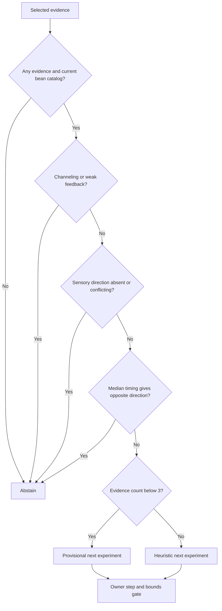

| Condition | Result |
| --- | --- |
| no selected evidence | Abstain. |
| current bean catalog cannot be fetched/validated when evidence exists | Abstain or dependency failure; do not backfill historical beans. |
| one or two comparable shots | Return confidence provisional; direction only unless an owner-calibrated numeric step is available. |
| three to six comparable shots | Return confidence heuristic, not calibrated probability. |
| mark.taste supplied | Use controlled operator-selected taste label; sour contributes finer, bitter/astringent coarser. This is a taste heuristic, not a measured extraction diagnosis. |
| flavour.overall supplied | Map under-extracted to sour, over-extracted to bitter and balanced to balanced; this is the same operator assessment, not independent evidence. |
| flavour acidity, bitterness or astringency intensity supplied | Descriptive only; no intensity threshold becomes a finer/coarser direction. |
| temperatures, descriptors, sweetness/body or sinceBrewMin supplied | Store as descriptive feedback; no formula converts them into a grind or temperature correction. |
| channeling or weak feedback | Abstain and ask for preparation/extraction evidence. |
| both finer/coarser sensory directions, or balanced plus directional feedback | Abstain on conflict. |
| no sensory direction | Retain balanced setting or request structured feedback. |
| configured TargetTimeSec is finite and median < target-tolerance | Timing direction finer; median > target+tolerance means coarser; equality is within window. |
| no explicit target time configured | Abstain before collecting the advice cohort; no silent 30-second fallback. |
| sensory and non-null timing direction disagree | Abstain. |
| sensory direction exists and timing agrees or is in window | Continue to bounded proposal. |

Behavior evidence: [test/bean-flavour.test.js](../test/bean-flavour.test.js), [test/first-shot.test.js](../test/first-shot.test.js), [test/suggestions.test.js](../test/suggestions.test.js).

## Direction, bounded number and physical display

A direction can be meaningful while a physical number is unavailable. A numeric proposal requires the owner to define one safe step and the usable limits.

Functions: `suggestion`, `dialNumber`, `dialReferenceFor`.

[Open full-size SVG](decision-trees/proposal.svg) · [Mermaid source](decision-trees/proposal.mmd)

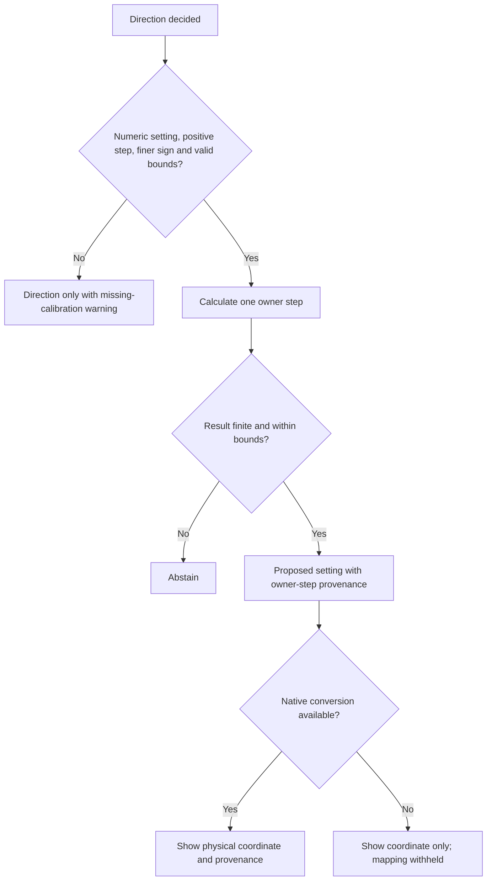

| Condition | Result |
| --- | --- |
| current setting is not a plain decimal number; step <=0; sign not +/-1; bounds non-finite/not increasing; current outside bounds | Keep direction-only proposal with warning. |
| all numeric prerequisites hold | next = current + step * sign * (finer ? 1 : -1). |
| next non-finite or outside inclusive bounds | Abstain; do not clamp to a boundary. |
| next valid | Round representation to 12 significant digits; identify as one owner-calibrated step. |
| physical conversion unavailable or invalid | Keep research coordinate separate and explain withheld physical mapping. |

Behavior evidence: [test/suggestions.test.js](../test/suggestions.test.js), [test/first-shot.test.js](../test/first-shot.test.js), [test/grinder-instances.test.js](../test/grinder-instances.test.js).

## Recall a marked-good setting

Recall returns a recorded setting rather than inventing an adjustment. This path has weaker completeness requirements than rich advice and reports unavailable comparison fields.

Functions: `recommendation`, `compare`, `historicalContext`.

[Open full-size SVG](decision-trees/recall.svg) · [Mermaid source](decision-trees/recall.mmd)

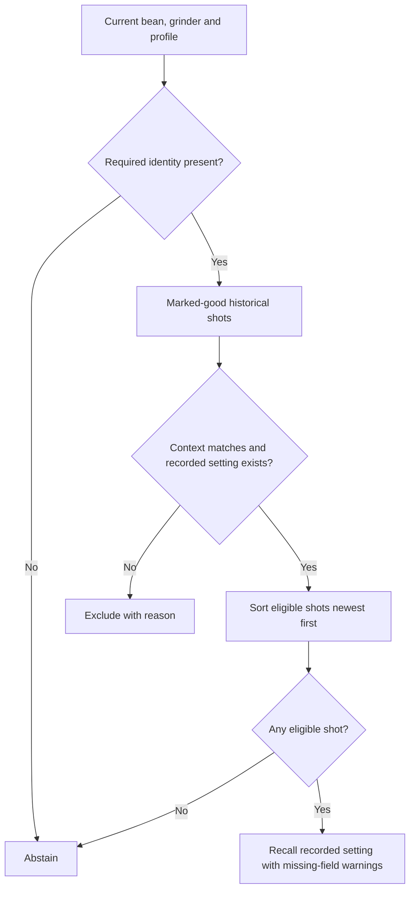

| Condition | Result |
| --- | --- |
| current beanBatchId, grinderId or execution profile missing | Abstain. |
| feedback.good is not true | Ignore shot. |
| historical confirmation conflicts, profile absent, or setting absent | Exclude. |
| compare returns ok | Consider; both-side missing fields remain warnings. |
| no candidates | Abstain, mentioning history bound when truncated. |
| candidates exist | Return newest timestamped candidate setting, recordedValue true, sourceShotId and warnings. |

Behavior evidence: [test/plugin.test.js](../test/plugin.test.js), [test/edge_cases.test.js](../test/edge_cases.test.js).

## Convert a grinder coordinate

Printed marks, clicks, mechanical gap and research dD are not interchangeable. A manufacturer step size alone does not identify an absolute zero.

Functions: `createGrinderDialTools.normalize`, `createGrinderDialTools.toGrinderDial`, `anchors`, `checkCalibrationRange`, `boundedDd`.

[Open full-size SVG](decision-trees/dial.svg) · [Mermaid source](decision-trees/dial.mmd)

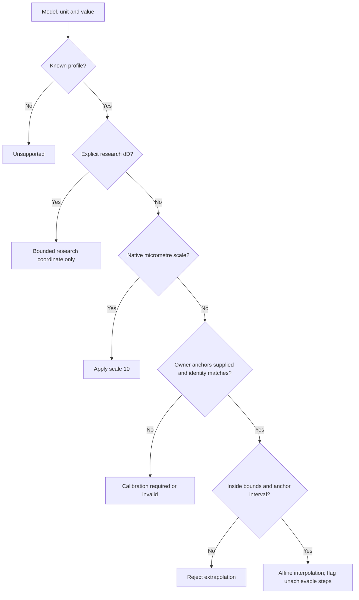

| Condition | Result |
| --- | --- |
| model unsupported | Return unsupported without algorithm/native coordinate. |
| input explicitly dD | Accept bounded signed 32-bit integer coordinate; no physical interpretation. |
| native micrometre profile has algorithmScale10 | Convert um *10 to dD or dD /10 to native units. |
| unit does not match profile or stepped input not whole step | Reject. |
| no native scale and no owner anchors | Return calibration-required. |
| anchors identity/model/burr/epoch/unit mismatch, non-finite or coincident anchors, invalid bounds | Reject. |
| requested value outside configured bounds OR outside interval spanned by anchors | Reject extrapolation. |
| valid anchors and interpolation | Apply affine slope (ddB-ddA)/(dialB-dialA). |
| inverse value falls between physical steps | Return achievable false and warning; do not silently round to a hardware click. |

Behavior evidence: [test/research-algorithms.test.js](../test/research-algorithms.test.js), [test/grinder-instances.test.js](../test/grinder-instances.test.js).

## Host grinder records and owner profiles

A model name describes a product family. The stable host ID identifies the individual unit whose burrs and zero were calibrated.

Functions: `validateGrinderProfile`, `grinderProfilesEndpoint`, `dialReferenceFor`, `saveGrinder`, `selectGrinder`.

[Open full-size SVG](decision-trees/grinders.svg) · [Mermaid source](decision-trees/grinders.mmd)

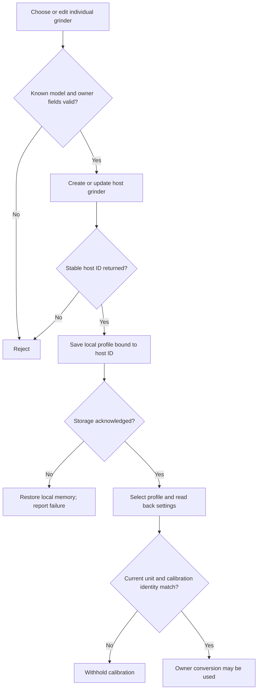

| Condition | Result |
| --- | --- |
| host response lacks a nonempty stable ID | Reject UI save/load result. |
| local profile has unknown fields, invalid ID, missing label/model/host ID/burr/epoch/source or invalid anchors | Reject. |
| creating profile when already 100 exist | Reject; updates remain allowed. |
| owner profile mismatches current host grinder, model, burr identity or epoch | Withhold its calibration. |
| host create/update succeeds but local save fails | Report failure; the already saved host record may exist. |
| profile selection POST succeeds | Read settings back and require selected ID matches. |
| delete/upsert/selection persistence fails | Restore prior in-memory profile/selection; report error. |

Behavior evidence: [test/grinder-instances.test.js](../test/grinder-instances.test.js), [test/ui.test.js](../test/ui.test.js), [test/lifecycle.test.js](../test/lifecycle.test.js).

## Feedback, bean dose and persistence

Feedback is kept beside a shot. The dose captured on an auxiliary bean scale is only accepted with explicit operator confirmation and source identity.

Functions: `validateFlavour`, `validateMeasuredBeanDose`, `validateConfirmedContext`, `timingFeedback`, `feedbackFromStorage`, `persist`, `loadStorage`.

[Open full-size SVG](decision-trees/feedback.svg) · [Mermaid source](decision-trees/feedback.mmd)

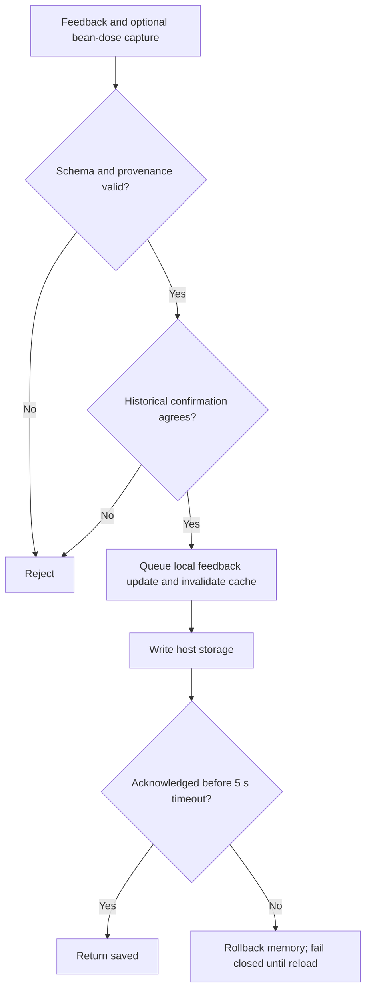

| Condition | Result |
| --- | --- |
| flavour intensity outside 0..5, temperatures outside 0..150 C, sinceBrewMin outside 0..10080, unsupported field or invalid descriptor list | Reject feedback; descriptors limited 12 entries each 64 characters. |
| measured bean dose lacks auxiliary role, beans purpose, grams unit, positive finite weight, deviceId, valid ISO timestamps or userConfirmed true | Reject; sampleTimestamp can explicitly be null. |
| confirmed context conflicts with saved shot | Reject. |
| brewTimeClock without valid brewTimeSec, unsupported clock, or non-boolean manualStopConfirmed | Reject; legacy time feedback without clock migrates to pump. |
| taste or flavour.overall supplied | Validate controlled taste labels and explicit under-extracted/over-extracted/balanced/uncertain overall assessment; descriptive intensities do not supply intent. |
| valid timing feedback | Persist brewTimeSec, brewTimeClock and boolean manualStopConfirmed; manual-stop confirmation is separate from elapsed time. |
| valid feedback | Serialize writes; change cache generation; await host storage acknowledgment before saved:true. |
| storage read invalid, write/read times out after 5000ms, or plugin unloaded | Fail closed; restore prior in-memory entry on failed write. |
| late storage acknowledgment after timeout | Do not recover the broken stream silently; reload is recovery boundary. |
| measured bean dose plus final measured beverage mass | Compute beverage-mass / confirmed-bean-dose ratio, not extraction yield. |

Behavior evidence: [test/bean-flavour.test.js](../test/bean-flavour.test.js), [test/lifecycle.test.js](../test/lifecycle.test.js), [test/analysis-endpoint.test.js](../test/analysis-endpoint.test.js).

## Research request and isolated comparison

These calculations replay a particular recovered firmware model. They do not inherit the rich assistant's context/taste protection. A valid calculation is not evidence that it is suitable for a physical grinder.

Functions: `research`, `createResearchAlgorithms.compareAll`, `validateState`, `checkInput`, `adjust`.

[Open full-size SVG](decision-trees/research.svg) · [Mermaid source](decision-trees/research.mmd)

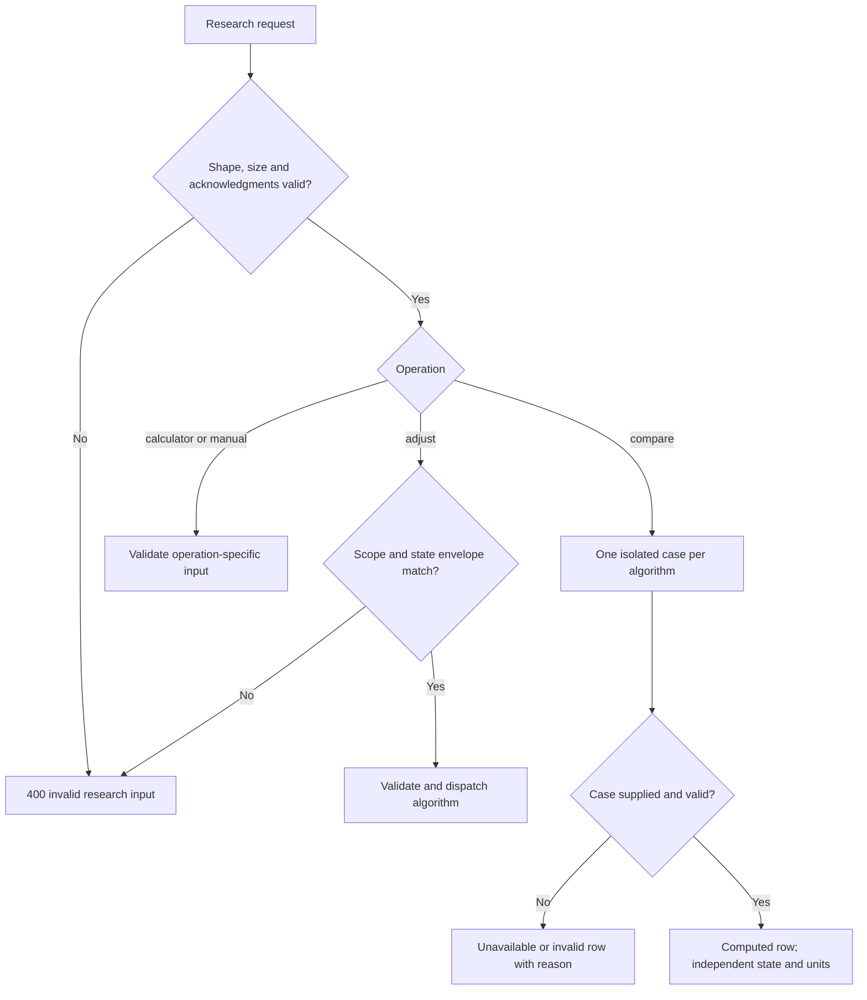

| Condition | Result |
| --- | --- |
| invalid object, missing operation/input, request >32768 serialized characters | Reject research request. |
| operation other than manual without exact firmwareBuild and deci-micrometre acknowledgment | Reject. |
| adjust without full grinderId/beanBatchId/burrIdentity/calibrationEpoch/profile scope | Reject. |
| state envelope algorithm/build/unit/scope/version differs | Reject mixed state. |
| invalid timing integers, algorithm-specific history/state bounds, or non-finite/out-of-int32 result | Reject. |
| compare case missing | Unavailable result for that algorithm. |
| compare case invalid | Invalid result with reason; other isolated cases still run. |
| compare case valid | Computed per-case result and separate state; comparable is computational availability, not common physical meaning. |

Behavior evidence: [test/research-endpoint.test.js](../test/research-endpoint.test.js), [test/research-algorithms.test.js](../test/research-algorithms.test.js), [test/research-parity.test.js](../test/research-parity.test.js).

## GbS1 smoothing and commit

Two separate decisions occur: update a candidate from recent time history, then decide whether to return it. Being inside the caller tolerance holds the previous result.

Functions: `newState`, `v1`, `adjust`.

[Open full-size SVG](decision-trees/gbs1.svg) · [Mermaid source](decision-trees/gbs1.mmd)

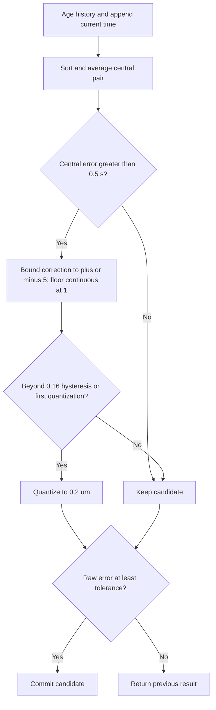

| Condition | Result |
| --- | --- |
| history entry age >=3 | Drop before incrementing remaining ages; empty history seeds four copies ages 0..3. |
| absolute central time error <=0.5 s | Keep candidate; no correction. |
| central error >0.5 s | correction = clamp(-(32768/(central-5)^3+0.2)*(target-central), -5,5); singular central 5 rejects. |
| continuous outside previous quantized +/-0.16 um, or no previous quantized value | Quantize to 0.2 um using half-away rounding; continuous lower bound 1 um. |
| absolute raw timing error >= caller tolerance | Commit candidate; equality commits. |
| raw error below tolerance | Return previous committed result, initialized from estimatedDdDum. |

Behavior evidence: [test/research-algorithms.test.js](../test/research-algorithms.test.js), [test/research-parity.test.js](../test/research-parity.test.js), [test/research-golden.json](../test/research-golden.json).

## GbS2 regression and shared inverse regression

The recovered model uses a negative setting/time slope. Its fallback and slope cap are replay constants, not a proof about every grinder.

Functions: `v2`, `inverseRegression`, `blend`.

[Open full-size SVG](decision-trees/gbs2.svg) · [Mermaid source](decision-trees/gbs2.mmd)

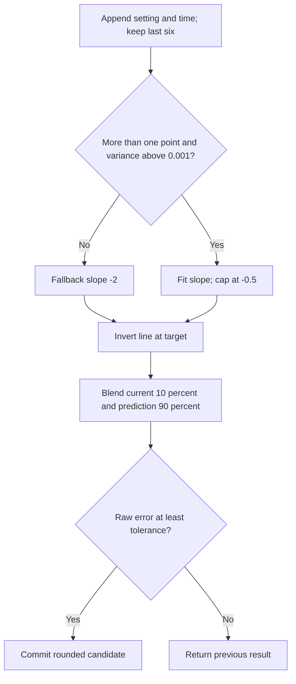

| Condition | Result |
| --- | --- |
| input points count not 1..6 or non-finite coordinate/time | Reject. |
| one point or x-variance <=0.001 | Use slope -2. |
| more than one point and x-variance >0.001 | Fit slope; cap any slope greater than -0.5 at -0.5. |
| GbS2 step | Append current setpoint/time; keep last 6; invert fitted line at target. |
| normal GbS2 prediction | Blend10% current,90% prediction with same-sign bounding; round output to dD. |
| raw absolute timing error >= tolerance | Commit; otherwise retain last result initialized from estimate. |

Behavior evidence: [test/research-algorithms.test.js](../test/research-algorithms.test.js), [test/research-parity.test.js](../test/research-parity.test.js).

## GbS3/GbS4 cancellation, phases and locks

Phase selection changes how much of the recent fitted trend contributes. Startup holds and the special GbS4 lock take precedence over the ordinary phase boundaries.

Functions: `family`, `newState`, `validateState`.

[Open full-size SVG](decision-trees/gbs34.svg) · [Mermaid source](decision-trees/gbs34.mmd)

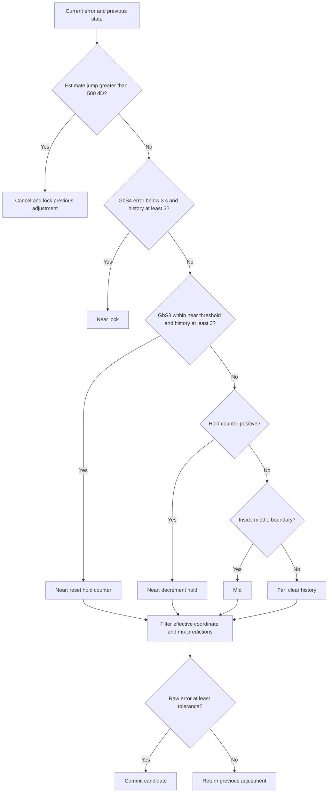

| Condition | Result |
| --- | --- |
| previous target/adjustment exist and abs(estimate-lastTarget)>500 dD | Cancel: update lastTarget, return previous adjustment locked, no normal update. |
| GbS4 error <3 s and history length >2 | Lock near and return prior adjustment; exactly 3 does not lock. |
| GbS3 error <=nearThresholdSec (default 2) and history length >2 | Near; reset hold counter (default 2). |
| otherwise holdCyclesRemaining >0 | Decrement counter and choose near. |
| otherwise error <=5 s, or GbS3 keepMediumIntervalWidth true and error <=nearThreshold+3 | Mid. |
| otherwise | Far and clear history. |
| phase not far | Append pair; keep last 6. |
| filtered effective coordinate unset | Initialize estimate_um*actual_s; otherwise retention filter(default 0.5). |
| fewer than 2 history points | Hyperbolic prediction only; otherwise regression blended 40% current 60% prediction. |
| phase factor | Interpolate hyperbolic to linear with far 0/mid 0.5/near 1 defaults. |
| raw error >= tolerance | Commit candidate; otherwise keep previous adjustment. |

Behavior evidence: [test/research-algorithms.test.js](../test/research-algorithms.test.js), [test/research-parity.test.js](../test/research-parity.test.js), [test/research-golden.json](../test/research-golden.json).

## DdEff, effectiveDd, grindTime and starting wizard

These helpers answer different mathematical questions. Their outputs have different units and cannot be ranked as competing grind recommendations.

Functions: `adjust`, `ddEff`, `effectiveDdPrediction`, `adjustGrindTime`, `proposedDd`.

[Open full-size SVG](decision-trees/calculators.svg) · [Mermaid source](decision-trees/calculators.mmd)

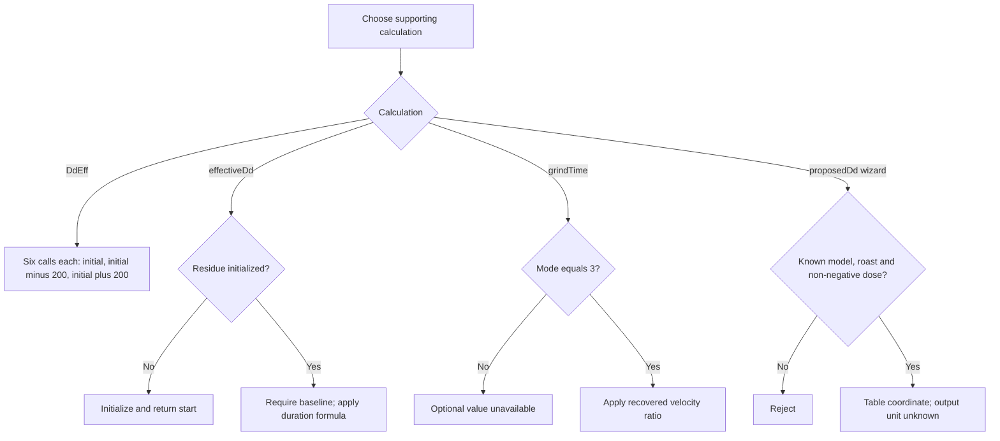

| Condition | Result |
| --- | --- |
| DdEff call | Return initial+[0,-200,+200][floor(calls/6)%3], increment calls; no timing/taste adaptation; state count must remain 0..64. |
| ddEff convenience helper calls missing or supplied | Default18; explicit signed integer must be0..64; zero returns no values. |
| effectiveDd has no residue | Initialize residue to grindDdDum/10 and return starting dD. |
| effectiveDd has residue | Require finite caller baseline; use k=ln(2)/1.85, a=1-exp(-kt), b=0 when t0 else 1-a/(kt); update residue with a, output baseline+(x-baseline)*b. |
| grindTime mode !=3 | Return adjustedTimeMs null, optional false. |
| grindTime mode 3 with valid inputs | round((1+0.0022017*recipeUm)/(1+0.0022017*targetDum/10)*recipeTimeMs). |
| proposedDd known model/roast and weightMg >=0 | trunc(offset+coefficient*weightMg/1000+0.5): model coefficients E64 3.5/E65 4/E80 6; roast offsets light-20/medium 0/dark 20. |
| proposedDd output | coordinateUnit unknown; never assume micrometres or copy into a native dial. |

Behavior evidence: [test/research-algorithms.test.js](../test/research-algorithms.test.js), [test/research-parity.test.js](../test/research-parity.test.js).

## Replay observations and separate algorithm states

Simulation is an explanation tool. Explicit observations and fictional plant observations are labelled separately, and each recovered algorithm gets its own state.

Functions: `createSimulationEngine.validateScenario`, `runOne`, `run`, `deserialize`, `replayRichSuggestions`.

[Open full-size SVG](decision-trees/simulation.svg) · [Mermaid source](decision-trees/simulation.mmd)

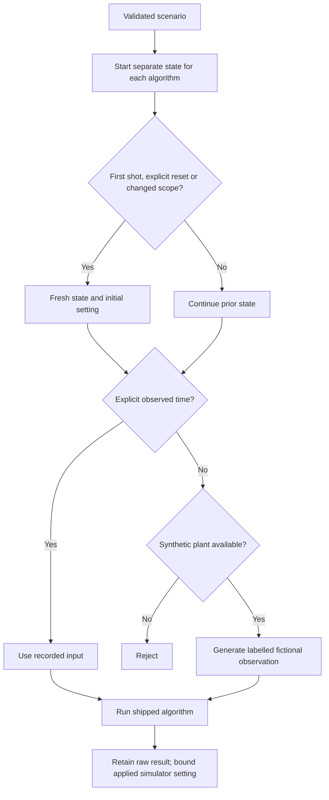

| Condition | Result |
| --- | --- |
| invalid schema, unknown fields, invalid signed 32-bit values, more than 100 shots or input JSON over 256KiB | Reject at the relevant scenario boundary. |
| first shot, explicit reset true, or any scope identity changes | Create fresh algorithm state and reset current coordinate to scenario initial setting. |
| planned actual time supplied | Replay that observation unchanged as explicit input. |
| actual time absent and synthetic plant supplied | Generate synthetic-plant observation; otherwise reject. |
| setpoint or estimate outside scenario bounds | Reject. |
| algorithm result outside simulator bounds | Keep raw output for inspection and clamp applied simulation setting separately; this is not the rich suggestion path. |
| algorithm run | Consume time/coordinate/tolerance; report beanType, roastLevel, taste and flavour as ignored by the recovered arithmetic. |
| rich suggestion replay requested | Run the shipped plugin against mock pressure-profile records, explicit pump-clock feedback and an isolated mock host; this exercises software logic, not hardware. |
| planned.overall explicitly supplied | Accept only under-extracted, over-extracted, balanced or uncertain; never derive overall assessment from sour/bitter/astringent labels. |
| synthetic duration | Simulator labels it as synthetic or caller-supplied pump duration; it is not a measured machine clock. |

Behavior evidence: [test/simulator.test.js](../test/simulator.test.js), [test/simulator-ui.test.js](../test/simulator-ui.test.js).

## Reference loading, reviewed facts and photo rights

A reference can explain a grinder or coffee without changing a recommendation. A link to a photograph is not permission to embed that photograph.

Functions: `reviewedReferenceContext`, `createReferenceCatalog.matchReferences`, `renderReferenceDetails`, `renderDialReference`, `renderDialPanel`, `reusableImage`, `simulator/app.js.loadCatalog`, `loadCoffeeCatalog`, `loadDialProfiles`, `showResourceRetry`.

[Open full-size SVG](decision-trees/reference.svg) · [Mermaid source](decision-trees/reference.mmd)

```mermaid
flowchart TD
L[Website coffee or grinder reference request] --> M{Request and resource shape valid?}
 M -->|No| N[Show unavailable and retry; retain entered setup and history]
 N -->|Retry| O[Disable clicked button while loading]
 O --> L
 M -->|Yes| P[Refresh reference display; preserve selected model when available]
 P --> A[Matched reference or grinder image]
 A --> B{Contextual source fact or image?}
 B -->|Fact| C[Display scope, facts and provenance]
 C --> D[Does not alter calculation or historical record]
 B -->|Image| E{Explicit reusable rights and safe image/license URLs?}
 E -->|Yes| F[Display photo with credit]
 E -->|No| G[Schematic or source link]
 F --> H{Image fails in simulator?}
 H -->|Yes| G
 H -->|No| I[Keep photo]
```

| Condition | Result |
| --- | --- |
| website coffee catalog request fails or products is not an array | Set unavailable state and show visible Retry coffee catalogue; manual coffee entry remains usable. |
| website grinder-reference request fails or models is empty/missing | Show Retry grinder references in the Simple-visible status; retain selected grinder and entered history. |
| reference retry clicked | Disable that button and mark Retrying while fetching; another failure renders a fresh usable retry button. |
| coffee catalog retry succeeds | Clear unavailable state and redraw products without resetting shot history. |
| grinder-reference retry succeeds | Clear status, refresh reference metadata and picker; retain selected model if still present, otherwise choose first returned model; re-render without resetting shot history. |
| reviewed reference-catalog request fails or schemaVersion !=1 or sources is not an array | Show Unavailable plus error in reference shelf; this older source-facts loader has no retry button. |
| exact supported grinder/burr/bean match | Return scoped offline references, deduplicated by source ID; reference facts do not change the suggestion. |
| reference URL is not credential-free HTTPS | Do not make it a usable external source link. |
| photo renderAllowed is true, safe HTTPS URL/license URL exist, and license is allowlisted reusable | Display the photo with attribution/license. |
| photo rights unverified or URL invalid | Use a local schematic where the UI supports it; retain source link rather than embedding the image. |
| external allowed image fails to load in simulator | Fall back to the repository schematic. |
| no native coordinate conversion | Display research/recorded coordinate and unavailable conversion explanation. |

Behavior evidence: [test/reference-data.test.js](../test/reference-data.test.js), [test/ui.test.js](../test/ui.test.js), [test/simulator-ui.test.js](../test/simulator-ui.test.js).

## Offline coffee catalog normalization

Catalog records preserve product identity and source coverage. They do not prove stock, roast freshness, a recommended grind, or species. Missing facts remain unknown.

Functions: `scripts/update-coffee-catalog.py.normalize_shopify`, `normalize_jsonld`, `validate`, `main`.

[Open full-size SVG](decision-trees/catalog-data.svg) · [Mermaid source](decision-trees/catalog-data.mmd)

```mermaid
flowchart TD
A[Offline source export] --> B{Shopify or JSON-LD?}
 B -->|Shopify| C[Require coffee product type, title and handle]
 B -->|JSON-LD| D[Require Product or ProductGroup with name and URL]
 C --> E[Apply source-specific product-form rules]
 D --> E
 E --> F[Preserve known facts; unknown values stay null]
 F --> G{Catalog schema, identities and safe URLs valid?}
 G -->|No| X[Reject]
 G -->|Yes| H{Check mode?}
 H -->|Yes| I[Verify deterministic representation]
 H -->|No| J[Write validated offline catalog]
```

| Condition | Result |
| --- | --- |
| Shopify export lacks products list or source URL is not credential-free HTTPS | Reject. |
| Shopify record lacks title/handle or product_type is not kaffee/coffee/café/cafe | Skip record. |
| Shopify tags identify green coffee, bundle, capsule or ground coffee | Classify that form; otherwise keep format unknown. Bundle also includes an abo substring in the title. |
| JSON-LD record is not Product/ProductGroup or lacks name/url | Skip record. |
| JSON-LD name/URL contains set, capsule/kapsel, drip bag, cold brew, cascara, advent calendar/adventskalender, multipack, probierset, entdecker or geschenkabo | Classify capsule when capsule/kapsel appears, otherwise bundle; unmatched records remain unknown. |
| normalized form is whole-bean | Set beanEligible true only for whole-bean; parser default unknown is false. Reviewed catalog enrichment is distinct from this conservative parser. |
| explicit decaf evidence present | Set true; absence remains null. |
| invalid envelope/schema, duplicate IDs, unsafe URL, invalid category/form/eligibility or missing source link | Reject catalog. |
| updating one source | Replace that source and its products; retain other sources; validate before writing. |
| --check | Compare deterministic serialization and fail drift without changing file. |

Behavior evidence: [test/coffee-catalog.test.js](../test/coffee-catalog.test.js).

## Four steps and Simple/Expert presentation

The wizard controls the visible task panel. Website Simple provides a native-dial manual experiment; Expert exposes recovered calculations and saved-trace analysis. Neither mode makes evidence more reliable.

Functions: `showNativeWizardStep`, `showWizardStep`, `simulator/app.js.init`, `modeToggle.onclick`.

[Open full-size SVG](decision-trees/ui-modes.svg) · [Mermaid source](decision-trees/ui-modes.mmd)

```mermaid
flowchart TD
A[Open task] --> B[Step 1: coffee and equipment]
 B --> C[Step 2: recipe and profile or brew model]
 C --> D[Step 3: trace and taste]
 D --> E[Step 4: compare results]
 E -->|Next| E
 F[Simple or Expert toggle] --> G{Expert?}
 G -->|Yes| H[Expose technical controls and details]
 G -->|No| I[Hide expert details]
 J[Algorithm or experiment context changed] --> K[Reset experiment history]
```

| Condition | Result |
| --- | --- |
| Back, Next or direct step selected | Clamp step to 1..4 and hide other step panels; update aria-current and step status. |
| first step | Disable Back. |
| fourth step and Next | Remain at results; do not wrap or mutate experiment. |
| native Expert toggle | Show expert-panel elements and update aria-pressed/help text; Simple hides them. |
| simulator mode | Persist simple/expert preference when available; Simple shows native-dial brew/taste/next-shot panels, Expert shows research simulation and actual-trace tools. Their histories and advice paths are separate. |
| website theme toggle or reload | Persist light/dark preference when localStorage is available; theme changes presentation only. |
| algorithm selection changes | Reset experiment rather than mix algorithm histories. |
| setup context or individual grinder changes | Reset affected experiment so observations are not silently reassigned to new equipment/beans. |
| helper wizard selected | Expose model/roast/dose input for proposedDd; label unknown output unit. |

Behavior evidence: [test/ui.test.js](../test/ui.test.js), [test/simulator-ui.test.js](../test/simulator-ui.test.js).

## Manual native-unit experiment

This helper accepts a caller-selected time target and explicit taste intent. It does not diagnose extraction from arbitrary prose or infer that acidity is undesirable.

Functions: `recommendManual`.

[Open full-size SVG](decision-trees/manual.svg) · [Mermaid source](decision-trees/manual.mmd)

```mermaid
flowchart TD
A[Explicit target, observed time and optional taste intent] --> B{All input and profile checks pass?}
 B -->|No| X[Reject]
 B -->|Yes| C[Collect out-of-window time direction and exact taste intent]
 C --> D{Balanced, conflict or no direction?}
 D -->|Yes| E[No adjustment]
 D -->|No| F[Heuristic finer or coarser experiment]
 F --> G{Current dial, calibrated numeric sign and step present?}
 G -->|No| H[Direction only]
 G -->|Yes| I{Candidate inside reference range?}
 I -->|No| J[Withhold numeric setting]
 I -->|Yes| K[Show one-step proposed dial]
```

| Condition | Result |
| --- | --- |
| profile not e64ws/df54/df64_gen1/df64_gen2; invalid positive target/actual time or non-negative tolerance; invalid direction/sign/step/range | Reject. |
| manual toleranceSec omitted | Use1 second; this is a software default, not a universal espresso tolerance. |
| actual < target-tolerance | Add finer time direction; actual > target+tolerance adds coarser; equality is inside tolerance. |
| trimmed lowercase flavor exactly too sour, too acidic or under-extracted | Add finer sensory-test direction. |
| flavor exactly too bitter, too astringent or over-extracted | Add coarser sensory-test direction. |
| other free text, including bare sour/bitter or negation | Ignore as taste evidence; an out-of-window time signal can still supply a direction. |
| flavor balanced OR conflicting finer/coarser directions OR no direction | Return direction none. |
| one agreed direction | Return confidence heuristic; legacyScore is 0.55 plus 0.15 per extra agreeing reason capped 0.9, explicitly not probability. |
| E64 WS profile | Require settingUnit micrometres; reject stepMarks and rotation direction; use positive stepNative and nonnegative current native display number. |
| dial-mark profile with stepNative | Reject; these profiles use stepMarks. |
| direction plus currentDial, positive unit-appropriate step and numericFinerDelta +/-1 | Calculate one native numeric step; DF64 reference interval is 0..90, E64 WS candidates must remain nonnegative. |
| candidate non-finite or outside model reference range/native lower bound | Withhold proposedDial and explain; keep directional result. |
| physical turn | DF54 default finer counterclockwise; DF64 default finer clockwise; explicit valid override wins; coarser reverses it. E64 WS physicalTurn is null and has no rotation inference. |

Behavior evidence: [test/research-algorithms.test.js](../test/research-algorithms.test.js), [test/research-endpoint.test.js](../test/research-endpoint.test.js), [test/simulator-ui.test.js](../test/simulator-ui.test.js).

## Import a simulator experiment

An imported experiment carries its own historical grinder identity and recipe. Validation protects those associations before replaying the recovered calculations.

Functions: `simulator/app.js.importFile`, `simulator/app.js.validateScenario`, `validImportNumber`, `validProfile`.

[Open full-size SVG](decision-trees/scenario-import.svg) · [Mermaid source](decision-trees/scenario-import.mmd)

```mermaid
flowchart TD
A[Selected scenario file] --> B{Size and JSON valid?}
 B -->|No| X[Reject]
 B -->|Yes| C{Schema, ranges and allowed fields valid?}
 C -->|No| X
 C -->|Yes| D{Profile IDs unique and existing-unit identities consistent?}
 D -->|No| X
 D -->|Yes| E{Historical rows and calibration valid?}
 E -->|No| X
 E -->|Yes| G{Preflight replay succeeds?}
 G -->|Yes| F[Apply imported experiment and replay completed rows]
 F --> H[Display replayed results]
 G -->|No| X
```

| Condition | Result |
| --- | --- |
| file missing | Do nothing. |
| file >256KiB, invalid JSON, version !=1, unknown envelope/setup/shot fields or more than 100 shots | Reject import. |
| setup numbers outside supported ranges | Reject: target 1..600 s; start 0..100000 integer dD; tolerance 0..60 s; plant 0.2..2; noise 0..10; pressure 0..15 bar; flow 0..20; dose 1..100 g; yield 1..200 g; optional preinfusion 0..30 s and pressure 0..15 bar. |
| required setup text empty/too long, unsupported algorithm/mode, invalid calibration or current native mapping | Reject. |
| grinderInstances supplied | Require 1..100 valid profiles, unique IDs, no conflicting existing same-ID unit and active ID present in imported list. |
| shot invalid | Reject: integer setting 0..100000; target 1..600; actual empty planned row or 0.1..600 s; valid pressure/flow/phase fields; controlled taste and optional explicit overall assessment enums; bounded historical context. |
| legacy dialCalibration lacks grinderId | Bind it to imported activeGrinderInstanceId, imported grinderId or current active ID before validation. |
| schema validation succeeds | Preflight the completed rows through simulationEngine.run before applying setup/profiles. |
| preflight replay fails | Reject without applying imported setup or profiles. |
| preflight succeeds | Apply imported setup/profiles, bind selected calibration and replay completed rows. |
| imported or existing active profile is absent | Use first available profile under current import code. |

Behavior evidence: [test/simulator-ui.test.js](../test/simulator-ui.test.js), [test/simulator.test.js](../test/simulator.test.js).

## Preview and explicitly import a coffee

A product reference is not a bean batch. The host import previews the record, asks for missing product facts, checks existing records, and confirms the saved identity.

Functions: `native page.renderCoffeeCatalog`, `safeReferenceUrl`, `simulator/app.js.renderCoffeeCatalog`.

[Open full-size SVG](decision-trees/catalog-import.svg) · [Mermaid source](decision-trees/catalog-import.mmd)

```mermaid
flowchart TD
A[Catalog reference] --> B{Host import or local setup?}
 B -->|Local| C{beanEligible exactly true?}
 C -->|No| X[Reference only]
 C -->|Yes| V[Reset local experiment and apply explicit fields]
 B -->|Host| D[First click: preview]
 D --> E{Unsupported product format?}
 E -->|Yes| X
 E -->|No| F{Whole-bean and decaf facts confirmed?}
 F -->|No| W[Wait for missing owner confirmation]
 F -->|Yes| G[Lock action; fetch host beans including archived]
 G --> H{Lookup succeeds and catalog ID exists?}
 H -->|No| Y[Show error]
 H -->|Yes| I{Matching catalog ID returned?}
 I -->|Yes| J[Reuse host record]
 I -->|No| K[Create host bean]
 J --> L[Read back host ID and catalog identity]
 K --> L
 L --> M{Identity matches?}
 M -->|No| Y
 M -->|Yes| N[Confirm import; batch details remain separate]
```

| Condition | Result |
| --- | --- |
| native catalog load fails or products is not an array | Show unavailable or no entries; no bean write. |
| website coffee catalog unavailable | Show explicit retry and retain manual entry; successful retry refreshes products without applying one or resetting history. |
| catalog search or Show more | Native and simulator show10 more matches at a time; native search covers name, publisher, origin, process and format. |
| first native import click | Show preview only; do not POST. |
| format is capsule, ready-to-drink, bundle, green-bean or ground | Disable host import as reference-only. |
| beanEligible is not truthy and format is not blocked | Require owner confirmation of roasted whole beans. |
| decaf is null or absent | Require explicit yes/no selection; preserve original unknown and owner confirmation in extras. |
| required confirmation missing or import already pending | Do not write. |
| catalog identity missing or GET beans?includeArchived=true fails | Abort import. |
| returned host record extras.catalogId matches exactly | Reuse existing record without POST. |
| no returned host record matches | POST catalog fields and source provenance; species/process/country/roast remain explicit or null; sourceOrigin stays metadata. |
| save returns stable ID | GET bean by ID; require matching ID and extras.catalogId before success. |
| host ID or readback identity missing/mismatched | Display error. |
| simulator product.beanEligible is not exactly true | Refuse local setup application; retain reference. |
| simulator eligible Use explicit fields | Reset experiment and apply available name/species/roast/publisher only; do not create a host bean or infer species from type. |
| published recipe reference is espresso-scoped with brewTimeSec | Separate starting-point button applies available dose/yield/time; ranges use arithmetic midpoint and absent fields stay unchanged. |

Behavior evidence: [test/coffee-catalog.test.js](../test/coffee-catalog.test.js), [test/ui.test.js](../test/ui.test.js), [test/ui-integration-audit.test.js](../test/ui-integration-audit.test.js), [test/simulator-ui.test.js](../test/simulator-ui.test.js).

## Display measured evidence and independent comparisons

The graph keeps each sensor in its own units. Profile references explain a recipe family without replacing the saved controller. Each calculation needs its own measurements.

Functions: `createDialinUiTools.renderTrace`, `createDialinUiTools.profilePicker`, `createDialinUiTools.supplementalInputs`, `createDialinUiTools.renderComparisons`, `simulator/app.js.compareAllCalculators`.

[Open full-size SVG](decision-trees/ui-evidence.svg) · [Mermaid source](decision-trees/ui-evidence.mmd)

```mermaid
flowchart TD
A[Evidence and optional inputs] --> B{Purpose}
 B -->|Trace| C{Timestamped points available?}
 C -->|No| U[Show unavailable]
 C -->|Yes| D[Separate sensor panels; stop at gaps and invalid samples]
 B -->|Profile reference| E[Describe reference; retain saved controller steps]
 B -->|Calculations| F[Build independent enabled cases]
 F --> G{Case computed?}
 G -->|No| H[Show unavailable or invalid reason]
 G -->|Yes| I[Show result, units, inputs and state]
 J[Evidence changes] --> K[Invalidate stale answer]
```

| Condition | Result |
| --- | --- |
| metrics.trace has no finite timestamp points | Show unavailable instead of drawing a trace. |
| trace contains machine flow, pressure or beverage mass flow | Draw separate numeric panels in ml/s, bar and g/s; temperature measurements have separate degree-C panels. |
| sensor sample is explicitly invalid or next same-sensor gap exceeds5 seconds | End line segment; unrelated sensor timestamps do not break the line. |
| observed phase role preinfusion | Shade its recorded boundaries and list phase source; no scheduled duration becomes observed shading. |
| profile reference selected | Display family, controls, maximum durations, exits and pinned source; saved shot steps remain authoritative. |
| supplemental calculator checkbox disabled | Omit that calculation case; missing required inputs remain unavailable or invalid. |
| supplemental calculator enabled | Build isolated inputs; proposedDd converts dose grams to weightMg; inverseRegression uses two entered points; effectiveDd has separate residue state. |
| imported shot used for recovered comparisons | Require integer current coordinate with explicit deci-micrometre unit and positive selected-clock time before constructing GbS1–4/DdEff cases. |
| synthetic completed rows used for comparisons | Replay each algorithm independently to construct its state before the final shot. |
| comparison row not computed | Display status and reason. |
| comparison row computed | Show calculation-specific units and result with expandable raw inputs/state; wizard output unit remains unknown. |
| evidence changes or async response generation is stale | Invalidate previous assistant result; stale result does not overwrite the new evidence. |

Behavior evidence: [test/ui-integration-audit.test.js](../test/ui-integration-audit.test.js), [test/ui.test.js](../test/ui.test.js), [test/simulator-ui.test.js](../test/simulator-ui.test.js).

## Import an actual saved shot and feedback

A real saved shot is a separate evidence source from fictional simulator passes. Its controller steps and timestamps are analysed by the same metrics factory as the plugin.

Functions: `simulator/app.js.importShotTrace`, `useImportedClock`, `currentImportedFeedback`, `runImportedAssistant`, `clearImportedTrace`.

[Open full-size SVG](decision-trees/trace-import.svg) · [Mermaid source](decision-trees/trace-import.mmd)

```mermaid
flowchart TD
A[Saved-shot file] --> B{Size, JSON, timestamp and measurements valid?}
 B -->|No| X[Reject; retain existing trace]
 B -->|Yes| C[Analyse with createBrewMetrics]
 C --> D{Trace and optional feedback valid?}
 D -->|No| X
 D -->|Yes| E{Still current import generation?}
 E -->|No| Y[Ignore stale result]
 E -->|Yes| F[Store real shot and render evidence]
 F --> G{Selected measured clock available?}
 G -->|Yes| H[Prefill its duration]
 G -->|No| I[Leave time blank]
 H --> J[Explicit saved time may restore matching clock]
 I --> J
 J --> K[Run shipped assessment or export shot and feedback]
```

| Condition | Result |
| --- | --- |
| file missing | Do nothing. |
| file exceeds4MiB, cannot be read, invalid JSON/object/timestamp, measurements missing or more than 20000 | Reject; retain existing imported trace. |
| createBrewMetrics.analyze yields no timestamped trace points | Reject; retain existing trace. |
| saved feedback invalid | Reject: unsupported taste/overall, tasting temperature outside 0..150 C, delay outside 0..10080 minutes, brew time not positive <=600 seconds, unsupported clock or non-boolean manualStopConfirmed. |
| validation succeeds and import generation is still current | Retain actual saved shot; render metrics; restore valid feedback; leave synthetic pass history separate. |
| selected clock pump/pouring is complete, or recording has finite duration | Prefill corresponding measured duration. |
| selected clock unavailable or incomplete | Leave time input blank; do not replace it with recording duration. |
| saved explicit brewTimeSec exists | Restore it with brewTimeClock, default legacy pump. |
| manual-stop checkbox or saved feedback confirmation | Restore, export and submit boolean manualStopConfirmed separately from time; clear resets it and edits invalidate prior assessment. |
| run actual-shot assessment | Use shipped plugin with isolated mock host holding actual saved workflow/shot and explicit feedback; missing host bean/calibration stays unavailable. |
| clear, reset or newer import occurs while async work is pending | Invalidate generation; ignore stale import/assistant completion. |
| export saved trace | Download actual shot and current feedback together as JSON. |

Behavior evidence: [test/ui-integration-audit.test.js](../test/ui-integration-audit.test.js), [test/simulator-ui.test.js](../test/simulator-ui.test.js), [test/brew-metrics.test.js](../test/brew-metrics.test.js).

## Your first and next real coffee on the website

The Simple website takes the numbers you read from your grinder and your own timer. Each next step uses the current shot and the manual taste rule; its visible shot list is not a learned response model or the matched-history assistant.

Functions: `simulator/app.js.recordSimpleShot`, `renderSimpleRecipe`, `initializeSimple`, `invalidateSimpleAdvice`, `clearSimpleShots`, `clearSimpleSetup`.

[Open full-size SVG](decision-trees/simple-website.svg) · [Mermaid source](decision-trees/simple-website.mmd)

```mermaid
flowchart TD
A[Your current dial, recipe and measured shot] --> B{Observation and recipe valid?}
 B -->|No| X[Ask for correction]
 B -->|Yes| C{Same pump clock and pressure recipe confirmed?}
 C -->|No| H[Keep setting; gather missing evidence]
 C -->|Yes| D{Taste useful and grinder supported?}
 D -->|No| H
 D -->|Yes| E[Apply shipped manual taste and timing rule]
 E --> F{Direction agrees and owner step is checked?}
 F -->|No| H
 F -->|Yes| G{Candidate within reference range?}
 G -->|No| H
 G -->|Yes| I[Show one native-dial step]
 I --> J[Record this shot in local history]
 H --> J
 J --> K[User accepts next setting]
 K --> L[Clear measured inputs; brew and taste again]
 L --> A
```

| Condition | Result |
| --- | --- |
| coffee name blank, current dial missing, or measured time not in (0,600] seconds | Ask for the missing observation; do not append a shot. |
| recipe dose/yield/target not positive, dose >100g, yield >200g or target >600s | Reject until recipe corrected. |
| optional cup temperature outside 0..150C or tasting delay outside 0..10080 minutes | Reject; valid notes remain descriptive. |
| pump-start timing and target-cup-weight confirmation absent | Keep current setting; request a repeated recipe measured on the same clock. |
| pressure-led recipe without programmed flow confirmation absent | Keep current setting; time alone cannot justify a change for an unknown/flow-controlled recipe. |
| taste not supplied | Keep setting and ask the operator to taste. |
| taste weak or channeling | Keep setting; check measured recipe or preparation before changing grind. |
| model is not E64 WS, DF54, DF64/DF64 Gen1 or DF64 Gen2 | Keep setting; no supported manual small-step rule. |
| Simple recipe and tolerance | Use the visible recipe target and configured tolerance; config fallbacks are28s and1s, not a learned or universal recipe. |
| supported model and evidence confirmations | Call recommendManual with actual/target time, configured tolerance and explicit taste intent; E64 WS uses micrometres and stepNative, DF models use stepMarks. No research-coordinate conversion. |
| balanced, conflicting direction or no manual direction | Keep setting; liking the coffee vetoes chasing the timer. |
| owner has not checked positive step size and numeric finer sign +/-1 | Request one checked physical movement before displaying a numbered adjustment. |
| owner step would leave manual reference range | Keep current setting and request limit confirmation. |
| valid proposedDial | Show one finer/coarser step in the grinder display unit; preserve dose and cup weight for the next experiment. |
| accepted entry, including keep-setting advice | Append current setting/time/taste/optional notes to in-memory Simple history and show step4; history does not estimate a slope and is separate from Expert scenario import/export. |
| Use this setting for my next shot | Copy proposed or retained native number to current dial, clear time/taste/clock confirmation and tasting notes, return to step3; user moves hardware manually. |
| current shot or dial-check input changes | Invalidate previous proposal and disable Continue until recalculated. |
| recipe or context changes | Reset Simple shot history alongside experiment history; every grinder-model change, individual grinder selection, burr or calibration change also clears checked Simple dial setup. |
| Start a new coffee | Clear Simple shot history, proposal, pressure confirmation and checked native-dial setup; return to step1. |

Behavior evidence: [test/simulator-ui.test.js](../test/simulator-ui.test.js), [e2e/novice.spec.js](../e2e/novice.spec.js).

## Fictional practice stays visibly fictional

Practice teaches the sequence of entering a shot, reading advice and trying another shot. Its preset dial and times are fictional examples, not a calibration or prediction of a real grinder.

Functions: `simulator/app.js.initializeSimple`, `clearSimpleSetup`, `clearSimpleShots`.

[Open full-size SVG](decision-trees/simple-practice.svg) · [Mermaid source](decision-trees/simple-practice.mmd)

```mermaid
flowchart TD
A[Explicitly start practice] --> B[Label fictional dial and pressure setup]
 B --> C[Request next practice shot]
 C --> D{Practice still active?}
 D -->|No| X[No action]
 D -->|Yes| E[Choose authored time offset and taste]
 E --> F[Run Simple manual decision rules]
 F --> G[Show Practice label and disclaimer]
 G --> C
 H[Start a new coffee or change grinder calibration] --> I[Clear practice setup]
```

| Condition | Result |
| --- | --- |
| Try a fictional practice example | Select DF64 Gen2 and its available individual profile; clear Simple history; explicitly label practice. |
| practice setup | Set illustrative current 20marks, step0.5marks and finer numeric sign-1; mark its fictional dial and pressure confirmations checked. |
| Try next practice shot while practice inactive | Do nothing. |
| practice shot requested | Set time to max(1,target+offset), with offsets-6,-2,0 for first, second and all later shots; confirm pump timing. |
| practice offset nonzero | Use too sour intent; zero uses balanced. These tastes are authored examples, not inferred extraction. |
| practice record | Run the same Simple manual gates; display practice disclaimer and label every history row Practice. |
| start new coffee or change individual grinder/burr/calibration | Clear practice setup and its pressure confirmation before using real observations. |

Behavior evidence: [test/simulator-ui.test.js](../test/simulator-ui.test.js), [e2e/novice.spec.js](../e2e/novice.spec.js).

## Native app: readable answer or owner-confirmed dial step

The native app first explains the saved-evidence answer in physical units when a verified conversion exists. Its separate manual form accepts an owner-checked physical dial step; that result is a new experiment, not a fitted grinder response.

Functions: `beginnerMessage`, `renderBeginnerAdvice`, `updateAdviceClock`, `nativeAdviceForm submit handler`, `clearAnalysisState`.

[Open full-size SVG](decision-trees/native-beginner.svg) · [Mermaid source](decision-trees/native-beginner.mmd)

```mermaid
flowchart TD
A[Native next-setting step] --> B{Saved assistant answer or manual form?}
 B -->|Saved answer| R{Recall of a good shot?}
 R -->|Yes| S{Saved number has explicit convertible unit?}
 S -->|Yes| T[Show recorded native number; verify on grinder]
 S -->|No| E
 R -->|No| C{Verified physical values available?}
 C -->|Yes| D[Show native value and physical-step caveat]
 C -->|No| E[Keep setting; explain missing evidence or conversion]
 B -->|Owner manual form| F{Completed pressure-compatible shot and matching grinder?}
 F -->|No| X[Explain why calculation is unavailable]
 F -->|Yes| G{Owner confirmation and numeric inputs valid?}
 G -->|No| X
 G -->|Yes| H{Taste absent, weak or preparation uncertain?}
 H -->|Yes| E
 H -->|No| I[Call isolated manual heuristic]
 I --> J{Current request and finite proposed dial?}
 J -->|Yes| K[Show one physical experiment]
 J -->|No proposal| E
 J -->|Stale| L[Ignore response]
```

| Condition | Result |
| --- | --- |
| saved recommendation has finite setting and explicit native source unit | Display native µm for micrometres/micrometre/µm, or marks for dial-mark/dial-marks/marks/owner marks/owner-calibrated marks; E64 WS explicit deci-micrometre divides by10. |
| saved recommendation unit unknown or value invalid | Withhold physical number; request verified units. A recalled number is a saved intended setting, not a live hardware reading. |
| saved answer has available finite currentNative and proposedNative | Show actual display units and amount; zero amount means keep setting. |
| converted proposal lies between physical steps | Ask the operator to choose and confirm a neighboring achievable mark. |
| native conversion or proposed value unavailable | Keep current setting for now and explain missing evidence or conversion; do not present research dD as a physical number. |
| manual form without analysed saved shot | Reject and request analysis in step3. |
| saved metrics.stopReason matches error, disconnected or stopping.?backstop | Reject interrupted-shot manual advice, even with a completion checkbox. |
| saved controlMode is not pressure or mixed_preinfusion_flow | Reject manual time-based dial calculation. |
| owner has not confirmed physical dial used for this saved shot, small adjustment, completed recipe and target measured on the same clock | Reject. |
| selected E64 WS/DF54/DF64 generation does not match normalized saved grinderModel | Reject; normalization ignores case and non-alphanumeric characters. |
| any numeric field blank, current/step/actual/target not finite, step not positive, actual/target outside (0,600], or finer sign not +/-1 | Reject; a blank current setting cannot become zero. |
| clock selector changes | Prefill finite selected-clock duration only for complete pump/pouring timing or explicitly chosen recording; otherwise leave measured time blank. |
| selected native manual model changes | Switch display labels between micrometres and marks; clear current/step/sign and owner confirmation; invalidate previous answer. |
| taste weak or channeling | Keep current native number and ask for dose/preparation/trace evidence. |
| native manual taste blank | Keep current number and ask for sensory assessment; the beginner UI does not invoke time-only manual advice. |
| saved setting has known native units | E64 WS accepts explicit micrometre aliases or divides explicit deci-micrometre by10 for consistency only; DF accepts dial-mark/dial-marks/marks/owner marks/owner-calibrated marks. |
| known saved native setting differs from entered current by more than 1e-7 | Reject historical-setting mismatch; unknown units stay unconverted and require the owner confirmation. |
| valid manual case | POST research operation manual with owner step/sign and same-clock times; E64 WS sends settingUnit micrometres and stepNative, DF models send stepMarks. This is separate from the rich history suggestion. |
| manual response has finite proposedDial | Show one physical step and ask to brew/taste before another change. |
| manual response lacks proposedDial | Keep current native number and show reasons, including balanced/conflict/range refusal. |
| form inputs change or analysed shot changes during request | Increment advice generation; stale response does not replace current advice. |
| feedback save succeeds | Invalidate previous beginner/manual advice and ask for a fresh assessment. |
| new analysis or shot selection | Clear existing beginner and manual advice and the intended-recipe checkbox before fetching new evidence. |

Behavior evidence: [test/ui.test.js](../test/ui.test.js), [test/ui-integration-audit.test.js](../test/ui-integration-audit.test.js), [e2e/native.spec.js](../e2e/native.spec.js).

