# Read the number on your grinder

## ELI5: one number, three different rulers

A DF64 collar number is like a mark on a volume knob. An E64 WS number is a distance displayed in microns. The recovered research algorithms use their own ruler: one dD is one tenth of a micron. Those numbers are not interchangeable.

For an E64 WS display, **50 µm = 500 research dD**. This changes the unit, not the coffee. It does not establish the grinder's operating limits, identify its firmware algorithm, or measure coffee particle size. Smaller displayed distance means finer grinding according to the manufacturer's original instructions.

For a numbered collar, **20 dial marks does not mean 20 µm**. A zero mark only identifies a reference. It does not tell us how much the burrs move between two marks. Your pointer, burrs, alignment and grinder generation matter.

## What the lab does

Choose your exact grinder model. Where a native conversion is documented, the lab can show both your grinder number and the internal research coordinate. Other numbered dials need explicit calibration before the lab converts a research result into a dial reading. Without it, research replay remains available and is clearly labeled as research coordinates.

Two calibration points describe a local straight-line conversion: a known dial number and its corresponding research coordinate at each point. The lab stores these with the grinder, burr identity and calibration epoch. These are explicit owner inputs, never inferred from a bean recipe or a photograph. A fictional mapping is useful for exploring the simulator, but does not become a measured physical calibration.

For example, a **fictional lab mapping** with dial 10 → 400 dD and dial 20 → 600 dD would display a result of 500 dD as dial 15. That is an arithmetic example, not a DF64 calibration constant or a suggested starting setting. Extrapolation beyond confirmed calibration points must not become a hardware recommendation.

## Keep zero and finer direction separate

- A printed zero may not currently be the burr-contact reference. Follow the exact manufacturer's procedure for your model.
- A clockwise turn and a decrease in the printed number are different facts. Record the observed numeric direction independently.
- Contact is a calibration reference, not a setting to brew at. The simulator never turns a grinder or asks you to reproduce contact while testing.
- Moving a pointer, replacing burrs, opening the carrier, alignment work or changing zero starts a new calibration epoch. Preserve older shots under their old epoch.
- Stepped grinders need achievable click/settings; a fractional calculated value is not automatically an attainable setting.

## Source and image scope

The grinder reference shelf lists reviewed model-specific markings, units, zero information and manufacturer mechanical movement where available. A published micron-per-click figure describes burr movement, not ground-particle size and not the response of a shot. Different burr geometries can produce different coffee at the same mechanical gap.

Original explanatory dial illustrations are schematic, not photographs or exact mechanical replicas. Manufacturer/product photographs and manual illustrations are linked with attribution; they retain their owners' copyright and are not included in the offline plugin package. Use the model/generation caption, not a picture of a similar grinder, to identify your control.

The [E64 WS original instructions](https://downloads.mahlkoenig.de/Service/Mahlkoenig_E64_WS_Espresso_Home_Original_instructions_EN.pdf), page 13, define the µm unit and finer/coarser direction. Page 26 describes fine disk-distance calibration. The public manual does not establish a universal operating range for this plugin.

## What a conversion cannot prove

Changing units does not make the recovered Mahlkönig formulas validated algorithms for another grinder. The lab reuses those formulas for transparent experiments; actual manual suggestions still need matched shots, bean context, taste evidence and an owner-confirmed local step. Burr-gap distance is not median particle diameter, and brew time alone is not extraction yield.

## Known model reference

| Model | What to enter | Calibration note | Source |
| --- | --- | --- | --- |
| E64 WS | µm; Electronic disc-distance value; no universal range verified | On-screen disk-distance calibration | [Reference](https://www.mahlkoenig.com/products/e64-ws-espresso-home-grinder) |
| E65S GbW | µm (DDD readout only); Use verified DDD distance, not an unmeasured adjustment-lever position | Manufacturer DDD calibration | [Reference](https://www.mahlkoenig.com/products/e65s-gbw) |
| E80S GbW | µm (DDD readout only); Use verified DDD distance, not an unmeasured adjustment-lever position | Manufacturer DDD calibration | [Reference](https://www.mahlkoenig.com/products/e80s-gbw-grinder) |
| DF64 Gen 1 | dial marks; Common 0–90-ish printed reference scale; owner-confirmed scale, not operating bounds | Owner-confirmed zero; printed zero may be offset | [Reference](https://support.clivecoffee.com/en/articles/16426035-df64-single-dose-user-manual) |
| DF64 Gen 2 | dial marks; Common 0–90-ish printed reference scale; owner-confirmed scale, not operating bounds | Movable indicator and burr changes require a fresh zero epoch | [Reference](https://df64coffee.com/products/df64-gen-2-single-dose-coffee-grinder) |
| DF54 | dial marks; Numbered stepless collar; confirm actual markings on your unit | Owner-confirmed indicator/zero | [Reference](https://df64coffee.com/products/df54) |
| Niche Zero | dial marks; Stepless numbered collar; manufacturer examples are recipes, not safe limits | Follow Niche calibration after relevant disassembly | [Reference](https://www.nichecoffee.co.uk/blogs/exploring-coffee/how-to-calibrate-your-grinder-for-optimum-performance) |
| Baratza Encore ESP | numbered settings; 1–40; 1–20 espresso, 21–40 coarser/filter; steps have two resolution bands | Shim/burr installation is calibration context | [Reference](https://www.baratza.com/en-dk/product/zcg495) |
| Timemore Sculptor 064S | dial marks; Stepless S model; do not substitute non-S burr/scale | Exact model, burr and RPM; reset after zero changes | [Reference](https://www.timemore.com/pages/sculptor-related-faq) |
| Timemore Sculptor 078S | dial marks; Stepless S model; do not substitute non-S burr/scale | Exact model, burr and RPM; reset after zero changes | [Reference](https://www.timemore.com/pages/sculptor-related-faq) |
| LAGOM 01 | micro-ticks; 7.5 µm per micro tick for the documented configuration; not grounds diameter | Configuration-specific zero, competition reference ±2 ticks | [Reference](https://www.option-o.com/guide-lagom-01) |
| LAGOM P64 | dial micro-ticks; Do not substitute LAGOM 01 pitch; local conversion required | Recalibrate after burr replacement; generation matters | [Reference](https://www.option-o.com/lagomp64userguide) |
| 1Zpresso X-Pro | clicks from zero; 60 clicks/rotation; 12.5 µm mechanical movement per click | Manual zero procedure; multi-turn count must be retained | [Reference](https://1zpresso.coffee/manual-xpro-en/) |
| 1Zpresso J-Max | clicks from zero; 90 clicks/rotation; 8.8 µm mechanical movement per click | Manual zero procedure; multi-turn count must be retained | [Reference](https://1zpresso.coffee/manual-jmax-en/) |
| 1Zpresso K series | clicks from zero; 90 clicks/rotation for reviewed K-Pro/K-Max/K-Plus; 22 µm/click; not K-Ultra | Model-specific zero; retain complete turns and clicks | [Reference](https://1zpresso.coffee/k/) |
| Fellow Ode Gen 2 | dial positions; Printed 1–11 dial with intermediate clicks; brewed-coffee grinder, not espresso | Stock and SSP calibration procedures differ | [Reference](https://fellowproducts.com/pages/gear-guide-ode) |

### Illustrated controls

These original schematic images work offline. The simulator shows these original illustrations. Manufacturer photos remain source links until a reusable licence is verified. The drawings deliberately avoid pretending an unverified scale is the exact factory marking pattern.

**E64 WS**

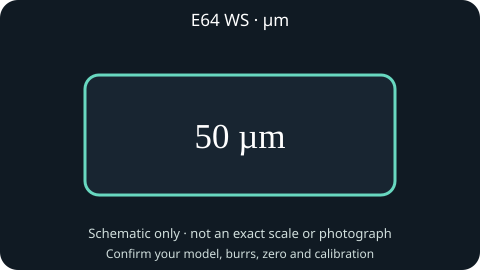

**E65S GbW**


**E80S GbW**

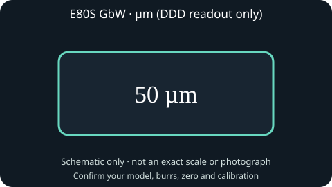

**DF64 Gen 1**

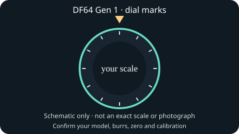

**DF64 Gen 2**

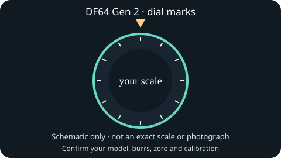

**DF54**

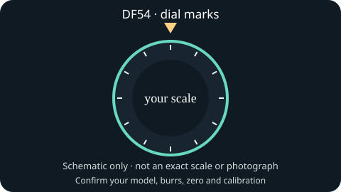

**Niche Zero**

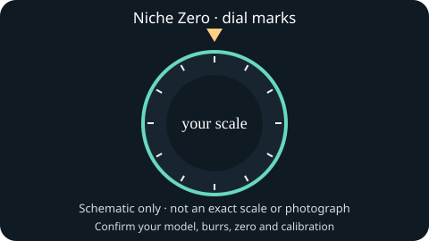

**Baratza Encore ESP**

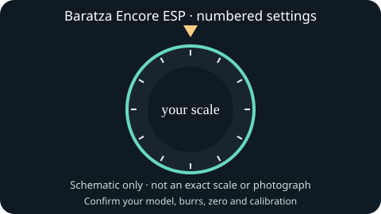

**Timemore Sculptor 064S**

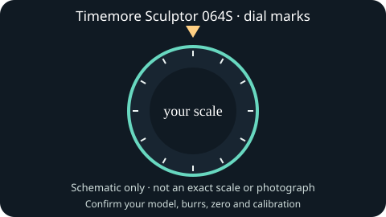

**Timemore Sculptor 078S**

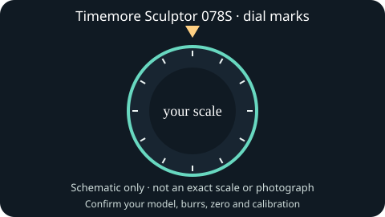

**LAGOM 01**

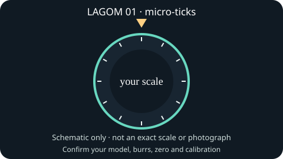

**LAGOM P64**

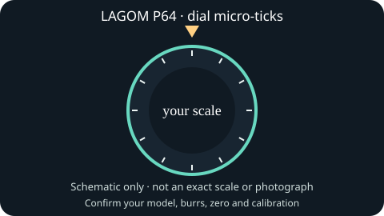

**1Zpresso X-Pro**

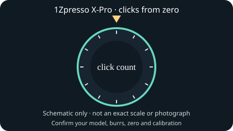

**1Zpresso J-Max**

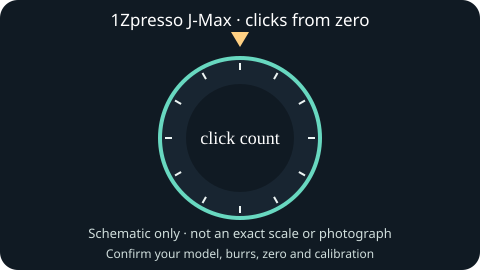

**1Zpresso K series**

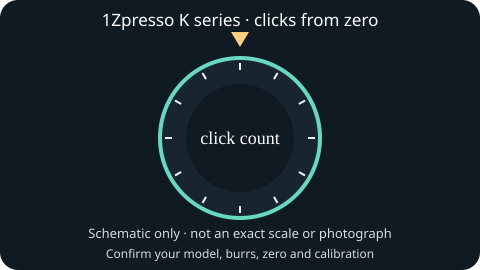

**Fellow Ode Gen 2**

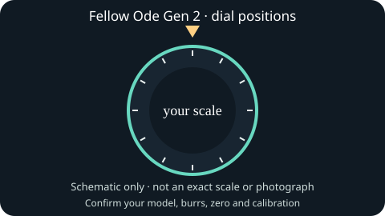


### Manufacturer pictures

The photos below are external source links. No reusable licence was verified for these 16 model references, so the application does not embed or redistribute them. A whole-grinder photo is not a calibration measurement. See the [image rights audit](GRINDER_PHOTOS.md) for the decision for each model.

- **E64 WS**: [View image](https://www.mahlkoenig.us/cdn/shop/files/E64-WS-Black-square_700x700.webp?v=1763414639) · [Source: Mahlkönig](https://www.mahlkoenig.com/products/e64-ws-espresso-home-grinder). E64 WS front product view; electronic adjustment/display is part of the unit.
- **E65S GbW**: [View image](https://www.mahlkoenig.us/cdn/shop/files/E65S_GbW_-_Black_560x700.webp?v=1761340232) · [Source: Mahlkönig](https://www.mahlkoenig.com/products/e65s-gbw). E65S GbW product view.
- **E80S GbW**: [View image](https://www.mahlkoenig.us/cdn/shop/files/E80S_GbW_-_Black_560x700.webp?v=1761340079) · [Source: Mahlkönig](https://www.mahlkoenig.com/products/e80s-gbw-grinder). E80S GbW product view.
- **DF64 Gen 1**: [View image](https://df64coffee.com/cdn/shop/products/IMG_8737.png?v=1626712036&width=1445) · [Source: DF64 Coffee](https://df64coffee.com/products/df64-single-dose-coffee-grinder). DF64 original-generation product photograph with numbered adjustment collar visible; not a calibration measurement.
- **DF64 Gen 2**: [View whole-grinder image](https://df64coffee.com/cdn/shop/files/64_GEN_2.png?v=1750929704&width=1946) · [Source: DF64 Coffee](https://df64coffee.com/products/df64-gen-2-single-dose-coffee-grinder). Official product photograph; image rights are not granted, so the simulator uses the repository schematic by default.
- **DF54**: [View whole-grinder image](https://df64coffee.com/cdn/shop/files/DF54.jpg?v=1738563824&width=1946) · [Source: DF64 Coffee](https://df64coffee.com/products/df54). Official product photograph; image rights are not granted, so the simulator uses the repository schematic by default.
- **Niche Zero**: [View image](https://cdn.shopify.com/s/files/1/0081/2076/2450/files/White_Niche_Zero_and_coffee_machine.jpg?v=1760088418) · [Source: Niche Coffee](https://www.nichecoffee.co.uk/blogs/exploring-coffee/how-to-dial-in-your-niche-zero). Niche Zero with dial visible in the manufacturer's dial-in guide.
- **Baratza Encore ESP**: [View image](https://assets.breville.com/cdn-cgi/image/width%3D333%2Cformat%3Dauto%2Cquality%3D75/ZCG495/ZCG495_Carousel1.png) · [Source: Baratza / Breville](https://www.baratza.com/en-us/product/encoretm-esp-zcg495). Encore ESP product/carousel view; official page describes the numbered adjustment collar.
- **Timemore Sculptor 064S**: [View image](https://www.timemore.com/cdn/shop/files/064S.jpg?v=1713171847) · [Source: Timemore](https://www.timemore.com/products/timemore-electric-coffee-grinder-sculptor-series). Sculptor 064S product view; official product page variant image.
- **Timemore Sculptor 078S**: [View image](https://www.timemore.com/cdn/shop/files/078S.jpg?v=1713171847) · [Source: Timemore](https://www.timemore.com/products/timemore-electric-coffee-grinder-sculptor-series). Sculptor 078S product view; official product page variant image.
- **LAGOM 01**: [View image](https://images.squarespace-cdn.com/content/v1/5b125642ec4eb782ce4f9947/1693535581758-AKATHPG9RWQ6M071BF8O/lagom%2B01.jpg) · [Source: Option-O](https://www.option-o.com/lagom-01). LAGOM 01 official product image.
- **LAGOM P64**: [View image](https://images.squarespace-cdn.com/content/v1/5b125642ec4eb782ce4f9947/8e408f57-ffa3-4196-bd61-4d2aab5671cf/LAGOM%2BP64.jpg) · [Source: Option-O](https://www.option-o.com/lagom-p64). LAGOM P64 official product image.
- **1Zpresso X-Pro**: [View image](https://i0.wp.com/1zpresso.coffee/wp-content/uploads/2022/08/3-1.jpg?fit=731%2C386&ssl=1) · [Source: 1Zpresso](https://1zpresso.coffee/manual-xpro-en/). X-Pro official adjustment instruction image.
- **1Zpresso J-Max**: [View image](https://i0.wp.com/1zpresso.coffee/wp-content/uploads/2021/07/J-Max-grinder-w-closeup.jpg?fit=1333%2C1000&ssl=1) · [Source: 1Zpresso](https://1zpresso.coffee/j/). J-Max product image with external adjustment ring.
- **1Zpresso K series**: [View image](https://i0.wp.com/1zpresso.coffee/wp-content/uploads/2021/06/KPRO-new.png?fit=1000%2C800&ssl=1) · [Source: 1Zpresso](https://1zpresso.coffee/k/). K-series external adjustment ring product image.
- **Fellow Ode Gen 2**: [View image](https://fellowproducts.com/cdn/shop/files/Web_PDP_OdeBrewGrinderGen2_Black_1_b979089a-570a-4024-99e7-dc5fcac0c69c.png?v=1780523585&width=1200) · [Source: Fellow](https://fellowproducts.com/collections/grind-brew/products/ode-brew-grinder-gen-2?variant=40978992463972). Ode Gen 2 official product image with large grind dial.

## Configure the installed plugin

The production assistant already learns and proposes a local manual step in the recorded setting unit. Keep `CurrentSetting`, `SettingUnit`, `StepSize`, `NumericFinerDelta`, `MinSetting` and `MaxSetting` in one consistent coordinate. These are explicit owner inputs and do not change a device. A known model alone does not invent a step size.

If your recorded setting uses research `deci-micrometre`, the E64 WS display conversion is automatic. For a numbered collar, the optional `DialCalibration` setting accepts a JSON string with the fields below. This **fictional arithmetic example** is deliberately not a DF64 physical calibration:

```json
{"model":"DF64 Gen 2","burrIdentity":"your exact burr identity","calibrationEpoch":"your current epoch","dialMin":10,"dialMax":20,"dialA":10,"ddDumA":400,"dialB":20,"ddDumB":600}
```

The model, burr identity and epoch must match current context. The assistant withholds a native conversion outside both confirmed anchor points or after an identity mismatch. It keeps the original recorded coordinate intact, and attaches the converted native value for display only. Invalid JSON or calibration is surfaced beside the suggestion. The plugin does not backfill a conversion into earlier shots.

For X-Pro and J-Max, store the **total clicks from the calibrated zero**, not just the repeating number printed on the ring. For example, X-Pro two full rotations plus 14 clicks is 134 clicks (60 per rotation); J-Max the same two turns plus 14 clicks is 194 clicks (90 per rotation). The shipped helper checks these counts and the lab displays the full turns alongside total clicks. A result between physical steps is labeled as such; it is not silently rounded to a motor command or an achievable recommendation.

Published pitch is reference metadata, not an automatically chosen calibration: X-Pro 12.5 µm/click, J-Max 8.8 µm/click and the reviewed K-Pro/K-Max/K-Plus 22 µm/click describe mechanical movement. LAGOM 01's 7.5 µm/micro-tick applies to its documented configuration. Absolute mapping still needs your zero/reference and calibration epoch; these values do not define ground-particle diameter or make recovered GBS formulas portable to a different grinder.


## Your individual grinders

Two grinders of the same model can have different burrs, zero points and alignment. Give each physical unit its own profile: for example, “Kitchen DF64 Gen 1” and “DF54”. Model names describe the design; instance IDs identify your particular machine.

In the simulator, add a grinder in the profile manager and select it before entering calibration anchors or running shots. Profiles are saved in this browser. Scenario exports include the selected profile; importing a conflicting profile ID is rejected. The simulator does not create a Decaid device or operate a grinder.

In the plugin, load Decaid’s grinder catalog and bind the calibration profile to an existing host grinder record. Creating a grinder uses Decaid’s existing grinder API and its returned ID. Owner calibration remains plugin metadata. Selecting a calibration profile does not change the grinder associated with an existing shot or workflow: the actual workflow ID must match before its calibration applies.

A conversion requires the same individual grinder, model, burr identity and calibration epoch. Recalibrate after changing burrs or redefining zero. Old calibrations without an individual identity need to be re-entered for the correct unit. Mechanical gap, particle size and brew response remain different quantities; the research coordinate is not a measured gap just because a graph displays it.
