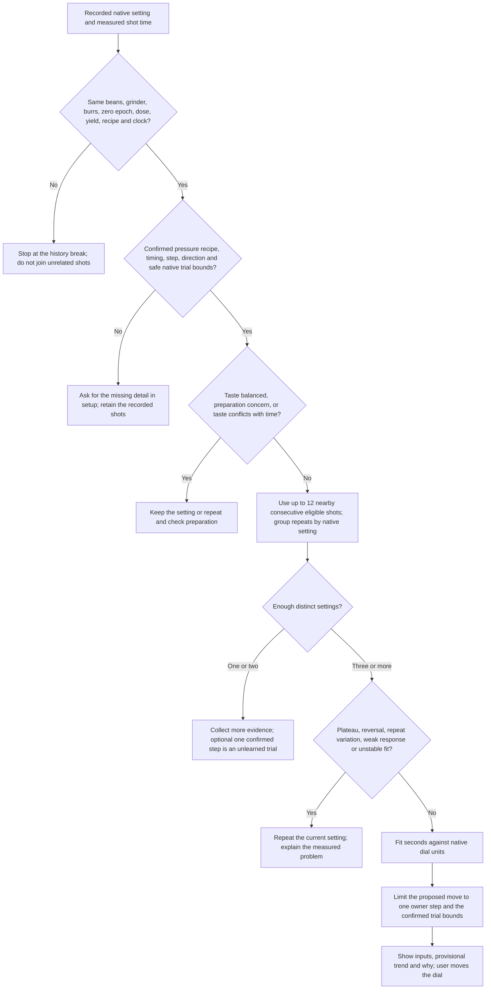

# Grinder setup and small native adjustments

The app's editable presets cover all 16 catalogued grinders. A preset suggests a small first experiment; it does not calibrate your grinder's response or convert dial marks to microns.

## What can work without calibration

The app offers **small native adjustments**: for example, “Try half a dial mark finer; taste the next shot.” This requires a repeatable movement and confirmed direction, not a measured burr gap or a calibrated response formula. An exact numeric destination additionally requires the current setting and an unambiguous coordinate. Physically calibrated research calculations remain separate. A preset never supplies a micrometres-per-mark value or marks the grinder response as calibrated.

Distinguish three independent facts in setup:

1. **Dial reference:** current reading, which way is finer, whether zero/indicator has moved, and what a unit means.
2. **Mechanical resolution:** actual clicks or documented burr movement per tick. This is not particle diameter; conical burr axial movement is particularly not an absolute grind-gap measurement.
3. **Observed brew response:** what this coffee, burr set and recipe did after a known adjustment. Only this supports learning a local response, and it can change when the recipe or coffee changes.

An unknown zero should not leave DF54/DF64 users with manual calculations as their only useful choice. Allow a relative adjustment without requiring a burr-touch calibration. If direction is unknown, show “move a small amount toward the grinder's finer marking” and ask the user to identify numeric direction before generating a numeric destination. Do not infer a valid physical range from a printed scale or force a blind move across zero.

The strongest model-specific numerical finding is **DF64 Gen 2: 0.5 scale mark**. Kaffeemacher observed sometimes 2–3 seconds of shot-time difference from that movement in its own testing. This justifies half a mark as an editable starting trial, **not** a universal seconds-per-mark coefficient. [Kaffeemacher DF64 Gen2 test](https://kaffeemacher.ch/blogs/kaffeewissen/g-iota-df64-gen2)

## Editable starting presets

“Trial choices” below are proposed UI choices, not tested safe operating bounds. They are deliberately editable. Confidence concerns the stated evidence, not guaranteed coffee quality. A “minimum native increment” is a mechanical fact; choosing it as the first correction is a cautious product decision.

| Catalog model | Proposed first trial | Optional smaller/larger trials | Evidence and limits |
|---|---:|---|---|
| DF64 Gen 2 | 0.5 dial mark | 0.25 / 0.5 / 1 | Direct reviewer-observed increment; moderate confidence. Stock/SSP, indicator and zero context still matter. |
| DF64 Gen 1 | 0.5 dial mark | 0.25 / 0.5 / 1 | Low-confidence heuristic. Vendor says small movements; no numeric Gen1 prescription verified. |
| DF54 | 0.5 dial mark | 0.25 / 0.5 / 1 | Low-confidence heuristic. Precise stepless control verified; no model-specific numerical correction verified. |
| Niche Zero | 1 dial mark | 0.5 / 1 / 2 | Practice guidance names Niche and 1–2 marks; choose the lower end. Stepless, not clicks. |
| Baratza Encore ESP | 1 click | 1 | Verified discrete adjustment; use espresso band 1–20. No fractional clicks. |
| Sculptor 064S | 0.1 printed-number interval | 0.1 / 0.2 / 0.25 | Low-confidence visual-movement heuristic, only if owner can reproduce it. |
| Sculptor 078S | 0.1 printed-number interval | 0.1 / 0.2 / 0.25 | Same evidence limit; not a click and not transferred from non-S models. |
| LAGOM 01 | Owner-supplied step | Unknown | Tick mechanics are documented, but the owner must confirm the tick-to-printed-number mapping and variant. |
| LAGOM P64 | 0.1 printed number | Owner-editable | Manufacturer specifies 10 µm vertical movement per 0.1 line; the app chooses one line as a trial, not a guaranteed shot correction. |
| 1Zpresso X-Pro | 1 click | 1 | Verified 60 clicks/turn and 12.5 µm burr movement/click; effect on shot unknown. |
| 1Zpresso J-Max | 1 click | 1 | Verified 90 clicks/turn and 8.8 µm burr movement/click; effect on shot unknown. |
| 1Zpresso K-Pro/K-Max/K-Plus | 1 click | 1 | Verified 90 clicks/turn and 22 µm burr movement/click; excludes K-Ultra. |
| Mahlkönig E64 WS | 1 displayed µm | 1 / 2 / 5 | Reviewer observed small effects at 1 µm; confirm firmware increment. No universal response gain. |
| Mahlkönig E65S GbW | Owner-supplied small DDD change | Unknown | Manual adjustment with distance readout; exact display unit/resolution and repeatable movement must be confirmed. |
| Mahlkönig E80S GbW | Owner-supplied small DDD change | Unknown | Same limit; do not substitute E80W GbS electronic control. |
| Fellow Ode Gen 2 | None for espresso | None | Manufacturer says not suitable for espresso. |

All rows have direct source links and evidence notes in the [shipped grinder catalog](../data/grinder-dials.json). Null defaults mean unknown or unsupported, not zero movement. The app labels heuristic choices as starting trials rather than manufacturer recommendations. The optional choices in this table are examples to discuss and check against your grinder, not selectable guarantees or operating bounds.

## What setup should collect

Keep the first screen short: exact model/version, stock or changed burrs (with “unknown”), current setting (optional for relative advice), what one dial unit means, numeric finer direction, and the proposed small step with an editable value. Show advanced details only when relevant:

- **DF family:** seller/brand and generation or revision; stock espresso versus brew burrs; SSP exact geometry, not merely “SSP”; original versus replacement scale/indicator; whether indicator or burr seating recently changed. Vendor revision numbering is not globally consistent: the MiiCoffee DF54 page uses v1.2–v1.5 while another seller markets V4. Do not merge them into one generation enum without mapping evidence. [MiiCoffee DF54](https://miicoffee.shop/products/miicoffee-df54-single-dose-coffee-grinder), [DF Grinders guide and product menu](https://dfgrinders.com/pages/df54-grind-size-guide)
- **1Zpresso:** exact subtype, turns plus clicks or normalized total clicks; don't discard complete revolutions. The broad K-series entry must require K-Pro, K-Max or K-Plus confirmation. Keep K-Ultra, J-Ultra and other revisions separate. [K-series specification](https://1zpresso.coffee/k/), [J-Max manual](https://1zpresso.coffee/manual-jmax-en/), [X-Pro manual](https://1zpresso.coffee/manual-xpro-en/)
- **Stepless decimal dials:** distinguish one printed numeral interval from one minor tick. “One tick finer” on a LAGOM must not become subtracting 1 from a setting of 2.5. The JSON leaves tick-to-display conversion null where not verified, including DF minor-mark spacing and LAGOM ticks. Ask for the owner's tick spacing before calculating a destination.
- **Option-O:** exact burrs and RPM; P64 manufacture period, especially pre/post-August 2022; LAGOM 01 pre/current late-2024 configuration. A zero calibration is not a universal prerequisite or routine action. P64 guidance specifically separates burr replacement from ordinary cleaning. [P64 resources](https://www.option-o.com/lagomp64userguide), [LAGOM 01 resources](https://www.option-o.com/guide-lagom-01)
- **Sculptor:** 064S versus 078S, burrs, RPM and any zero-pin change. The S variants are stepless. Confirm numeric direction on the owner's wheel instead of confusing turn direction with number direction. [Timemore FAQ](https://www.timemore.com/pages/sculptor-related-faq)
- **Mahlkönig:** exact model, firmware, displayed unit and whether input is DDD distance or a mechanical scale. E65S/E80S GbW have manual adjustment and a readout; the existing catalog's `control: screen` is insufficient to imply motorized control. Use explicit units and no guessed ×1000 conversion. [E65S GbW quick start](https://downloads.mahlkoenig.de/Service/Mahlkoenig_E65S_Gbw_Espresso_Grinder_Quick_start_manual_DE_EN.pdf), [E80S GbW](https://www.mahlkoenig.com/products/e80s-gbw-grinder)

Store a setup revision when burrs, indicator/zero, shims, mechanical scale or model changes. Preserve old shot settings with their old revision; do not reinterpret them through the new reference. RPM/feed workflow and recipe changes should also invalidate an assumed unchanged brew response.

## Evidence boundaries and numeric direction

The DF64 vendor guide says clockwise is finer and counterclockwise coarser, and explicitly warns that SSP upgrades change sticker accuracy. Its small-adjustment advice supports a relative native trial; the proposed Gen1 half-mark value is our product choice. [Clive DF64 guide](https://support.clivecoffee.com/en/articles/16426035-df64-single-dose-user-manual)

The DF54 firsthand review confirms smooth stepless adjustment, but does not supply a measured half-mark correction. The proposed 0.5 value is therefore low confidence. Do not substitute the DF64 Gen2 observation as DF54 validation. Native lower-number direction should be confirmed against the actual fitted indicator, especially after modification. [Kaffeemacher DF54 test](https://kaffeemacher.ch/blogs/kaffeewissen/df54-test)

Niche explicitly identifies smaller numbers as finer. Kaffeemacher's general adjustment guidance mentions one-to-two marks for Niche; that supports starting at one, while leaving half a mark available near a good result. Its wording includes “clicks” generically, but Niche Zero itself is stepless. Do not adopt the Niche article's particle-size estimates or example 25–30-second recipe as universal profile targets. [Niche guide](https://www.nichecoffee.co.uk/blogs/exploring-coffee/how-to-dial-in-your-niche-zero), [Kaffeemacher adjustment guidance](https://kaffeemacher.ch/blogs/kaffeewissen/mein-mahlgrad)

For Encore ESP, decreasing numbered settings is finer. One click is repeatable, but the step size changes between the espresso and filter bands. The manual documents that added shims shift equivalent settings, so previous readings need a new reference after that change. The original ESP is not the new ESP Pro. [Baratza manual, pages 5–6 and 10](https://assets.breville.com/ZCG495/manual-encoreesp-v1-0-en-010923.pdf)

For the hand grinders, fewer total clicks from the correctly defined zero is finer. Do not use the visible single-turn numeral alone for X-Pro/J-Max. Their published micrometres refer to burr movement, not grounds diameter or an established shot response. [X-Pro manual](https://1zpresso.coffee/manual-xpro-en/), [J-Max manual](https://1zpresso.coffee/manual-jmax-en/), [K specifications](https://1zpresso.coffee/k/)

Option-O documents approximately 7.5 µm vertical movement per LAGOM 01 minor tick and expressly separates burr gap from particle size. This verifies mechanics only. The quick guide gives clockwise finer; numeric tick mapping still needs an explicit coordinate. Do not transfer this pitch to P64. [LAGOM 01 resource](https://www.option-o.com/wbrc-resource), [quick guide](https://static1.squarespace.com/static/5b125642ec4eb782ce4f9947/t/65014e5f10d31854a1996f30/1694584416447/LAGOM%2B01%2Bquick%2Bguide.pdf)

E64 WS explicitly uses displayed µm disk distance, with smaller values finer. Kaffeemacher's observed response to single-micron changes supports a small trial, not a deterministic conversion to seconds. Its ±10 µm window was around one coffee's starting example, not a recommended correction step or global bound. [Mahlkönig manual, page 13](https://downloads.mahlkoenig.de/Service/Mahlkoenig_E64_WS_Espresso_Home_Original_instructions_EN.pdf), [Kaffeemacher E64 WS test](https://www.kaffeemachers.shop/blogs/kaffeewissen/mahlkoenig-e64-ws)

Ode Gen2 remains excluded from espresso presets regardless of what aftermarket-burr discussions suggest. [Fellow support](https://support.fellowproducts.com.au/en_us/is-ode-gen-2-suitable-for-grinding-espresso-HJt8Rm8qZe)

## What remains unverified

No hardware trials were performed. No universal response curve, DF physical pitch, Sculptor numeric correction size, or E65S/E80S repeatable DDD increment was established. Some vendor-linked PDF downloads and embedded videos were unavailable; their unseen contents were not used as evidence. Sources that merely aggregate user settings or estimate particle sizes were excluded. All published shot-time examples remain local observations under particular recipes; they do not establish grind direction for flow-controlled Decent profiles or prove extraction quality from taste words alone.

## Learn from your shots: ELI5

Write down the number on your grinder and how many seconds your coffee took.
Keep the beans, ground-coffee weight, cup weight and machine recipe the same.
A few consistent adjustments let the app learn how this coffee responds to your
own dial. It never needs you to measure a burr gap.

For example, 22 marks → 34 seconds, 22.25 → 31 seconds and 22.5 → 31 seconds
shows that the latest movement did not shorten the shot. The app asks you to
repeat 22.5 before increasing the movement. It cannot tell whether that plateau
came from coffee preparation, normal variation or the grinder itself.

If three different nearby settings instead give a consistent trend, the app can
suggest one small, confirmed move in your dial's units. If you like the taste,
it keeps your setting even when the time differs from your target. Missing
confirmations or conflicting taste/time signals ask for more evidence.

## Native response decision flow

## Expert details

This separate shipped `recommendNativeResponse` method fits a local straight
line, `time = intercept + slope × native setting`, to median times at distinct
settings. Its slope is seconds per native unit. It never uses recovered firmware
fallback slopes, dD constants or an assumed micron conversion.

The exported `nativeResponseContract` documents all required scope fields and
confirmations. Screening uses at most 12 consecutive eligible shots within two
confirmed steps of the current setting. A scope, timing, recipe or preparation
break stops history collection. Three distinct settings are required for a learned
numerical proposal. Repeat spread, latest-response plateaus/reversals, weak
one-step effects, residual variation and leave-one-out slope sign instability
can hold the setting. These are conservative software rules, not universal
scientific thresholds or confidence probabilities. The owner time tolerance is
an acceptance window, not an independently measured uncertainty.

A target beyond measured settings is explicitly extrapolation. Every suggestion
is limited to one confirmed native step and owner-confirmed safe operating
bounds. Printed scale endpoints do not establish safe operating bounds; burr
contact is not a brewing setting. Fits do not diagnose extraction or puck prep.
See [NIST's regression guidance](https://www.itl.nist.gov/div898/handbook/pmd/section1/pmd141.htm)
for the limits of regression and extrapolation.

The ten recovered/manual comparison tools remain separate. Their inputs are
not interchangeable: grinding duration is not brew duration, table output with
unknown units is not a dial setting, and measured seconds per mark are not
physical burr-distance calibration.
