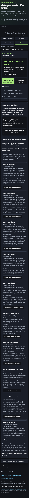
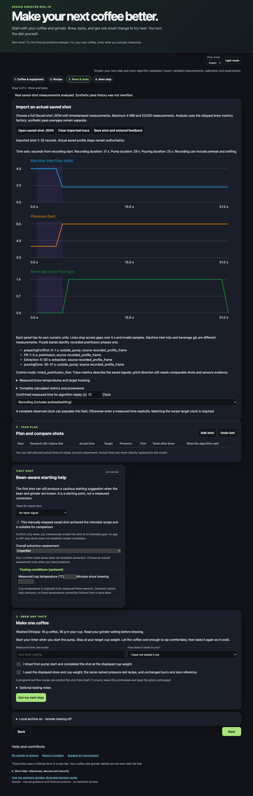

# Verification record — 2026-10-31

## Test matrix

| Suite | Result |
|---|---:|
| `npm test` (Node/plugin/simulator unit and integration) | **367 passed** |
| `npm run test:e2e` (Chromium, Firefox, WebKit + mobile viewport) | **176 passed** |
| `npm run test:telemetry` | **3 passed** |
| Decaid upstream-main QuickJS host runtime (`df177b75`) | **2 passed** |

The host runtime test loaded this repository's real `plugin.js` in the Decaid
host, exercised feedback persistence, suggestions, abstention and research
replay against the host API, and used the upstream `main` device/plugin
contract rather than the old `bafa9b3` pin.

## Browser/simulator evidence

The Playwright suite drives the local brew simulator and the native plugin
page with synthetic saved shots. It checks the complete novice journey,
algorithm cards, import/export, feedback persistence, research sharing,
native host responses and mobile layout.





## Scope

These are hardware-free fixtures. They do not prove physical grinder
performance, real Decaid account data, or a physical E64 connection. The E64
VM integration is recorded separately in
`MaxRink/decaid-e64ws-plugin/docs/VM_TESTING.md`.

## Commands

```sh
npm ci
npm test
npm run test:e2e
npm run test:telemetry
```
